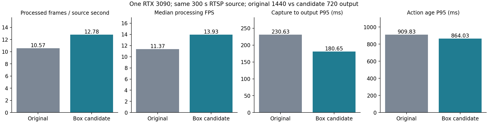
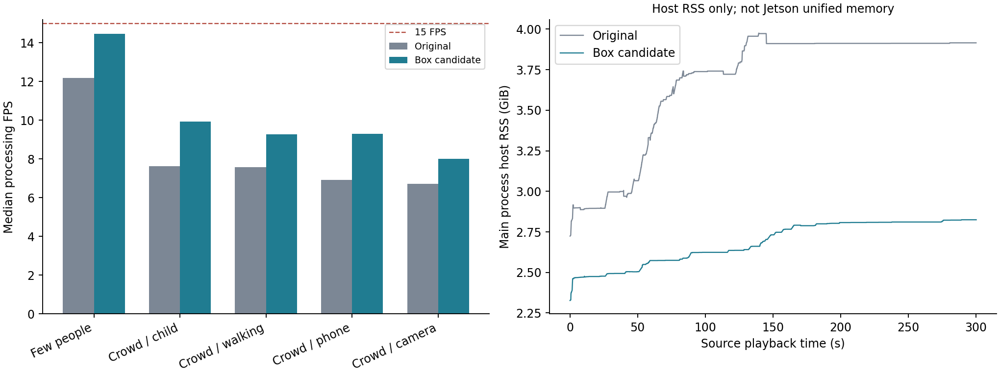

# NVIDIA-Box 单卡优化分析 · 2026-10-28

本轮完成 Box 专用候选与开发机单卡验证。**目标 Orin Nano 4GB Super 尚未接入，不能称为 Orin 真机验收或保证 4GB 内存足够。**
用户提供的是 ARM64、34TOPS、CPU/GPU 共享 4GB 内存及 256GB NVMe。NVMe 容量不等于 GPU 内存；TOPS 也不能直接换算此模型组合的 FPS。JetPack 版本未知，部署脚本当前目标为 JetPack 6 / Python 3.10 / TensorRT 10+，仍需本机验证。

## 采用的修改

- 只改 Box 运行时及其打包/部署工具。平台源码、四个交付归档和原 0.3.0 镜像另以 SHA/镜像 ID 核对。
- 六个模型及现场权重保持：Retinexformer、人体 YOLO26m、RTMO-s、逐人 ROI VideoMamba-Tiny、ST-GCN、七类物体 YOLO26m。本轮没有训练或采用新轻量学生模型。
- 人物 RGB 帧缓存从 512 帧 float32 改成 128 帧 uint8，缓存本体约 **525 MiB→33 MiB**；取批次后执行原归一化。此数字不包括模型/激活/解码等总内存。
- 人框/骨架匹配和人物重叠检测使用向量化计算。单卡实时独立动作线程、每人公平轮转、待处理窗口同人合并，批次上限 2。合并计数显式可见；离线逐帧排空。
- ARM64 自动 TensorRT：人体/物体 FP16、姿态 FP32（关闭 TF32），128 MiB builder 工作区；缓存绑定 ONNX 哈希、GPU、架构和 TRT 版本。只交付 ONNX，engine 必须板端构建。x86 的 auto 为 ORT CUDA，测试 TensorRT 时显式指定。
- RTMO 的 rank-1 ArgMax 做等价 Unsqueeze/ArgMax/Squeeze 改写；10 帧原/改 ONNX 在 ORT 下最大误差 0。此检查不证明 TensorRT 全链逐位相等。
- 增强保持原 PyTorch FP16，CUDA Graph 默认关闭。默认直接输出 720 长边，原版默认显示放大至 1440；**模型处理输入均为 720**。可加 `--sr bicubic --sr_scale 2` 恢复显示放大，速度另测。
- 原参数维持 alpha .972 / 原图门35 / 动作 .925 / 物体 .581；挥手同腕3真实帧、跑动 .35 框高/秒；物体框、人物框、骨架、人/动作并发片段、前后2秒均保留。

## 真实单卡推拉流

同一 GPU0（RTX3090）、同一 300 秒 25FPS/7500 帧输入，先 180 秒不同亮度/少人，后 120 秒四类多人场景；RTSP 输入→实际 RTMP 主动推送→外部 FFmpeg 录制，同时测试 MJPEG/FLV/HLS 观看者重连。没有像素条码。原版输出1440，候选720，故这是整个部署配置的比较，不能将收益全部归于 TensorRT。

| 指标 | 原 Box | 优化候选 |
|---|---:|---:|
| 实际处理帧数 / 7500 | 3170 | 3833 |
| 300 秒平均实际处理 FPS | 10.57 | 12.78 |
| 健康接口处理 FPS 中位数 | 11.37 | 13.93 |
| 健康接口处理 FPS 最低值 | 5.99 | 7.37 |
| 采集交付→输出 P95，ms | 230.63 | 180.65 |
| 动作结果年龄 P95，s | 0.910 | 0.864 |
| 动作结果年龄最大，s | 1.792 | 1.760 |
| 输出最大间隔，s | 0.350 | 0.334 |
| 主进程 RSS 峰值，MiB | 4071.1 | 2892.6 |
| 被新窗口替换的待处理任务 | 0 | 285 |
| 保存动作片段 | 38 | 29 |
| 前后上下文完整的片段 | 36 | 28 |

按 300 秒实际处理源帧计算，吞吐提高 **20.9%**。丢旧输入以控制延迟：候选消费 3833/7500 帧，未逐帧执行所有输入。编码器设定15FPS不等于模型15FPS。动作窗口合并不会排除某个人，但中间窗口不再逐一识别；短促动作召回尚未全面验收。

这张图同时展示速度与延迟，避免只报更高显示帧率。候选仍不能保证所有场景达到15FPS或每次动作结果小于1秒。

| 输入时段 | 原 FPS 中位数 | 候选 FPS 中位数 | 候选最多检测人数 |
|---|---:|---:|---:|
| Few people | 12.19 | 14.47 | 3 |
| Crowd / child | 7.63 | 9.94 | 13 |
| Crowd / walking | 7.57 | 9.28 | 14 |
| Crowd / phone | 6.93 | 9.30 | 12 |
| Crowd / camera | 6.72 | 8.02 | 18 |

相同输入帧数的5个离线探针补充如下；各配置每样本仅一次，非独立重复实验，不与实时FPS混算：

| 同源等长离线探针 | 帧数 | 原FPS | 候选FPS | 候选GPU MiB |
|---|---:|---:|---:|---:|
| crowd-camera | 150 | 6.89 | 7.86 | 1326 |
| crowd-child | 150 | 10.25 | 12.40 | 1344 |
| lighting-01 | 141 | 12.91 | 15.46 | 1192 |
| lighting-05 | 150 | 13.45 | 15.34 | 1292 |
| rule-喝水27 | 125 | 10.56 | 13.11 | 1322 |

拥挤场景仍是主要吞吐限制。RSS 是主 Python 进程，不包括所有编码/系统进程。RTX 独立显存与主机 RSS 不能直接相加当作 Jetson 统一内存；设备总容量、交换、温度及功耗需通过随包 tegrastats/benchmark 工具验证。

主流测试正常 SIGTERM 收尾，39 份视频严格完整解码通过；保存 29 个片段，其中 28 个有请求的前后上下文。写入失败、强制释放、放弃、写队列丢帧均0，输入重连 0、主动推流重启 0、HLS 重启 0。health 状态分布为 {'ok': 230, 'degraded': 10}。输出间隔超过1秒次数 0。健康接口可能把短时正在进行的编码写入标为 degraded；保留原始记录，不把它等同已证实断流，也不删除该状态。

本次唯一上下文不足片段在15秒分段上限处结束，前卷1.921秒、后卷0.719秒，元数据未把它标成完整。未裁的外部录制保留初始化及尾部黑画面；另生成299.933秒展示版full-output-5min.mp4，只裁两端连续黑画面，中间全部保留，另行严格解码。原始录制及裁剪边界见stream-trim.json。

延迟起于 OpenCV 交付解码帧，不包含相机网络缓冲；动作年龄统计包含本次会话启动尾部事件。只代表本机 loopback、本地盘、有限时间测试，不是无限流、Orin、平台 vGPU 或 NFS 保证。不同处理速度改变窗口相位和跟踪，片段/触发数量不能作为误报率对照。

## 故障与恢复

独立110秒测试，源暂停8秒、输出中继停止8秒、输入断开8秒以及观看者重连，均用本轮归档单GPU运行。

| 故障恢复动作 | health 恢复正常，秒 | 接收端重新收到画面，秒 |
|---|---:|---:|
| source_resume | 0.544 | 0.020 |
| output_up | 8.082 | 12.748 |
| source_up | 5.527 | 0.045 |

13 个片段，10 个上下文完整，其余断流/边界不足按元数据明示；写失败/强制释放/放弃均0，写队列丢帧 0。采集代次 [0, 1, 2]，正常退出后自有进程残留0。接收端恢复活动包括警告画面或重复末帧，不等于新鲜源画面的端到端恢复时间。缓冲帧在暂停后仍可能完成，详见 fault-verification.json。

## 识别与可视化检查

- 独立解包版本 **107 项 CPU 回归通过**；真实启动器、六模型自检记录见 archive-entry/ 与 archive-check-env.log。
- 固定人物输入204窗的缓存优化检查：最终标签0变化，RGB概率最大绝对差0.00233424。仅验证同ROI/同姿态的动作路径，不是检测/跟踪/异步调度的全链无损证据。
- 最终姿态FP32配置完整跑23历史样本，5207 帧、2395 人物窗、17 个自动片段；40 份完整输出/片段严格解码。覆盖原平均L约7–154、最多19个检测人物；3份回传已增强，原L未知。样本含历史训练/反馈，非独立泛化准确率。
- **已知误过滤变化保留**：喝水27原基准5个drink窗，TensorRT候选3个，仍保留该短片的喝水动作片段。两个窗口因人体/姿态局部ROI与检测数值变化失去物体支持；原瓶分数约.5834紧邻.581阈值。将姿态恢复FP32未消除这项差异，因此不能声称全部精度不变，也未擅自降低阈值掩盖它。
- 手机/相机误认瓶、部分旧误跑等既有问题并未通过执行优化解决。23样本没有完整逐帧逐人GT；触发数量下降不记作纠错。
- 与历史正式23输入相比，18份样本最终类别计数一致。5份有变化，其中crowd-camera的喝水1窗变0，lighting-06的跑动1窗变0；另有多人轨迹导致other窗口数变化。详见historical-label-counts.json。这些计数不构成同窗精度或误报率统计；即使上述两个历史误触发在本次短片中消失，也不能称已解决该类误报。

| 样本 | 平均原L | 最多检测人 | 离线FPS | 片段 | GPU MiB | 主进程RSS MiB |
|---|---:|---:|---:|---:|---:|---:|
| lighting-01 | 7.3 | 2 | 15.54 | 2 | 1192 | 2568 |
| lighting-02 | 8.2 | 3 | 15.66 | 2 | 1292 | 2645 |
| lighting-03 | 22.2 | 2 | 15.97 | 1 | 1292 | 2645 |
| lighting-04 | 37.2 | 1 | 13.18 | 0 | 1294 | 2662 |
| lighting-05 | 32.3 | 2 | 15.92 | 1 | 1310 | 2701 |
| lighting-06 | 52.3 | 2 | 13.81 | 0 | 1294 | 2687 |
| lighting-07 | 67.7 | 1 | 13.94 | 0 | 1326 | 2712 |
| lighting-08 | 89.2 | 1 | 12.53 | 1 | 1294 | 2718 |
| lighting-09 | 119.3 | 2 | 11.88 | 1 | 1294 | 2721 |
| lighting-10 | 120.4 | 3 | 12.43 | 0 | 1294 | 2696 |
| lighting-11 | 未知 | 4 | 19.40 | 0 | 1196 | 2698 |
| lighting-12 | 未知 | 8 | 16.39 | 0 | 1164 | 2736 |
| lighting-13 | 未知 | 16 | 14.01 | 0 | 1196 | 2785 |
| rule-挥手22 | 154.1 | 1 | 12.63 | 1 | 1294 | 2783 |
| rule-挥手32 | 120.5 | 2 | 13.88 | 1 | 1324 | 2783 |
| rule-追逐20 | 40.4 | 1 | 15.62 | 1 | 1326 | 2785 |
| rule-喝水27 | 120.8 | 1 | 12.88 | 1 | 1294 | 2799 |
| crowd-child | 108.2 | 13 | 10.92 | 3 | 1326 | 2905 |
| crowd-walking | 105.8 | 14 | 10.07 | 0 | 1326 | 2983 |
| crowd-phone | 99.4 | 14 | 10.29 | 1 | 1326 | 3000 |
| crowd-camera | 100.4 | 19 | 8.39 | 0 | 1326 | 3016 |
| new-01-wave-veto | 99.8 | 14 | 9.85 | 1 | 1326 | 3049 |
| new-07-standing-veto | 100.5 | 9 | 10.94 | 0 | 1294 | 2971 |

全部输出和片段：[index.html](index.html)。正式规则默认及每个模型训练来源见包内 models.json / box-models.json。

## 未采用或失败的候选

1. 首版 CUDA Graph 因 autocast 临时权重地址失效出现非法内存访问；关闭捕获时的缓存后修复，5样本197窗标签一致，但额外图池不适合4GB默认，故关闭。
2. TensorRT增强：原 ONNX 对 PyTorch 一个检查帧 PSNR67.55dB/MAE.0114；60帧 TensorRT FP16 最低PSNR27.88dB、最大MAE7.82，部分敏感层FP32后仍34.04dB/3.94，未达等价要求，拒绝进入交付。128MiB增强构建工作区不足的失败日志也保留。
3. 单卡动作batch1改善部分前端吞吐，但动作年龄P95升至1.119秒、max2.320秒，合并643窗；默认恢复batch2。
4. TRT姿态FP16是早期候选，live-trt-balanced/ 与 trt-final-demos/ 目录名虽有final字样，**不是当前交付精度配置**。最终依据 live-final/ 和 archive-demos/。
5. torch.compile增强仅微测25.42→18.03ms、首编译20.67秒；未集成，不计入本版收益。ORT FP16也只是微测。
6. TensorRT原RTMO rank-1 ArgMax解析失败已作等价图改写；TensorRT初始化改变locale导致中文读文件失败，已恢复locale并强制UTF-8。

## 可交付边界与下一步

本轮为功能完整的 Box 性能候选，**不是已验收的 Orin4GB 实时方案**。完整模型保留，x86单卡仍未全面达15FPS；仅凭这一轮优化不足以宣布4GB Orin目标达标。包内提供Jetson安装分支、本地engine构建、自检及测速工具；需匹配本机JetPack的ARM64 PyTorch/Triton/Mamba扩展。

若板端容量或速度仍不达标，下一轮应在固定现场验证集和误报约束下做增强蒸馏、人体/物体检测m→s及动作学生模型，分别验证漏报和误报后再替换。没有把尚未训练/验证的轻量模型作为当前功能完备的证明。
