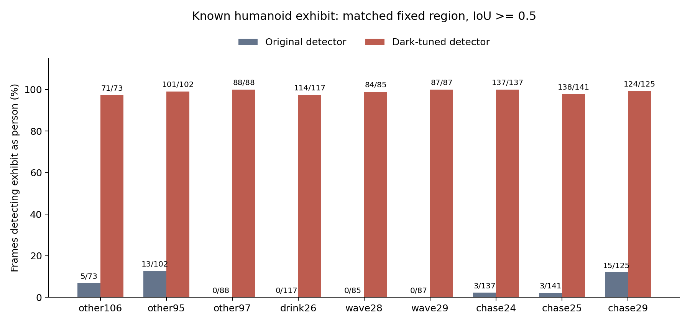
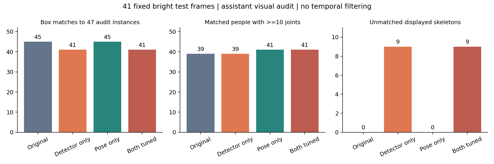

# 暗场微调模型的亮场回归 · 2026-10-24

**当前不能说“两种模型在亮场均保持原性能”。人体检测器有明确退化；姿态模型单独替换时，已核对真人上的骨架覆盖没有下降、略有改善，但尚不能据此证明关节点定位精度不下降。速度基本维持。**

用户本轮决定暂不使用推理平滑。此次全部输出为原始逐帧骨架，无 One-Euro、最短人物持续时间或关节连续确认；沿用原有置信度、NMS 和人体—骨架关联。之前的筛选训练标签和历史平滑演示保留，不改旧实验。现役平台和逐人运行候选原本都未接入上一轮演示里的 `CausalPoseFilter`，本轮无需修改生产入口。

[打开六段无平滑四组合视频及全部41帧对照](index.html) · [统计口径](stats-appendix.md) · [分析结论](analysis-report.md) · [图表解释](figure-catalog.md)

## 测试范围

- 使用冻结 test 划分中的全部真实原始亮场视频：**41 段、3,163 帧**，全部完整解码。原始 L 范围 **102.23–121.56**，满足 L≥75；本批没有覆盖75–102的过渡区或更强照明。
- 排除已增强线上回传切片，亮度只在720长边的未增强原图上计算；检测/姿态输入仍为相同的 Retinexformer 增强图。
- 原版和微调版 YOLO26m、RTMO-s 每个模型每帧各运行一次，并交叉组合为四套结果。394 帧复用上一轮同权重、同输入的原始输出，逐字段及原始L核验；其余 **2,769 帧新推理**。
- 固定上一轮验证集选出的检测第6轮、姿态第4轮权重；本次不重选权重、不扫阈值、不训练。人体阈值0.35、姿态框0.45、关节点0.30。
- 事先固定每段的中间亮帧，助手逐图核对得到 **47 个真人框**。另1名仅露头肩、身体严重遮挡者设忽略区域。框为助手近似视觉标注，未经独立人工精标；`visual-audit-labels.json` 保留坐标和来源，不加入训练。

这些是人体/姿态前端检查，不是 VideoMamba/ST-GCN 动作准确率、ABCP 行为套件或平台整链实时验收。

## 人体检测器：亮场退化，不适合直接替换

9 段同一视角的画面左侧存在固定人形展品，合计955帧。通过明确展品区域的 IoU≥0.5 匹配：

| 指标 | 原模型 | 暗场微调模型 |
|---|---:|---:|
| 展品被 YOLO 框成“人”的帧数 | 39/955（4.08%） | 944/955（98.85%） |
| RTMO 在展品区域输出姿态框的帧数 | 955/955 | 955/955 |
| 两模型组合后展品显示≥10点骨架的帧数 | 39/955 | 944/955 |

**原姿态模型也会给展品生成骨架。原检测器通常没有给它人体框，因此多数时候关联后不显示；微调检测器放出了展品人体框，导致假人和假骨架大增。** 单独换姿态模型时，展品显示仍为39帧；只换检测器就已升至944帧。这个退化不来自平滑。

| 视频 | 总帧 | 原检测误框展品 | 微调检测误框展品 |
|---|---:|---:|---:|
| other106 | 73 | 5 | 71 |
| other95 | 102 | 13 | 101 |
| other97 | 88 | 0 | 88 |
| 喝水26 | 117 | 0 | 114 |
| 挥手28 | 85 | 0 | 84 |
| 挥手29 | 87 | 0 | 87 |
| 追逐24 | 137 | 3 | 137 |
| 追逐25 | 141 | 3 | 138 |
| 追逐29 | 125 | 15 | 124 |

此外，微调检测器漏掉部分远处真人：挥手28中间帧原版检测3人，微调只检出1名真人并新增展品；挥手29、追逐25和other95中也出现远处真人丢失。不是单纯“框更松一点”。



## 姿态模型：单独替换的真人覆盖略改善，定位精度尚不能下定论

41个固定中间帧，人体框与47个辅助真人框按 IoU≥0.5 一对一匹配。有效骨架定义为关联同一人体框且至少10/17关节点置信度≥0.3。

| 组合 | 匹配真人框/47 | 匹配真人且≥10点的实例/47 | 未匹配框上显示≥10点骨架 |
|---|---:|---:|---:|
| 原检测＋原姿态 | 45 | 39 | 0 |
| 微调检测＋原姿态 | 41 | 39 | 9 |
| 原检测＋微调姿态 | 45 | **41** | 0 |
| 微调检测＋微调姿态 | 41 | 41 | **9** |

新增真人骨架来自 `other168` 的远处人物、`other185` 的弯腰人物；这41帧中未出现原本≥10点而单换姿态后不足10点的实例。原检测器47个输出包含1个忽略区域人物；另1个远处真人因辅助框边界较松，IoU略低于0.5，不能算背景误检。IoU降至0.3后，原/微调检测匹配为46/41，单换姿态的覆盖改善仍为39→41。完整0.3/0.5/0.7敏感性见统计附录。

**覆盖改善不等于关节点更准确。** 本批没有独立人工关节点GT，不能给出可信的亮场PCK/OKS/AP，也不能把“置信度高、点多”当作定位正确。特别是遮挡人物的隐藏肢体、远处人物关节，以及手腕细节仍需要人工精标核验。原、新RTMO都保留了展品假骨架问题。



全量3,163帧的关联≥10点人物帧数为原组合3,083、只换检测4,005、只换姿态3,261、两者都换4,115。它们包含误检，**不作为精度指标**；例如两者都换新增1,032个人物帧，其中展品误显示就净增905帧。

## 速度：单卡前端基本持平

同一张RTX3090（物理GPU2），41张亮场增强图，每模型先热身5图、再各测5遍，共205次；原/新执行顺序交替，包含预处理、ORT推理和NMS。

| 部件 | 原版中位 / P95 | 微调版中位 / P95 |
|---|---:|---:|
| YOLO26m | 16.92 / 18.63 ms | 17.05 / 19.07 ms |
| RTMO-s | 10.31 / 11.26 ms | 9.95 / 11.16 ms |

检测中位约增加0.13ms，姿态约减少0.36ms，未发现明显速度退化。此处不含增强、逐人动作识别、编码和网络，不能换算成全链路fps或延迟保证。

## 当前建议及交付范围

1. **亮场继续保留原人体检测器。** 当前暗场微调检测器不通过亮场回归，不能与姿态模型一起直接全场景替换。
2. **“原检测＋微调姿态”保留为单独候选。** 本批真人覆盖略好、耗时稳定；需要亮场关节点人工真值和逐人动作回归后，才能决定换装。此次没有替换。
3. 后续修正检测器时，在训练划分内混合亮/暗场、补足人形展品硬负例并约束原模型能力；本次测试反例不得直接回灌后继续称独立测试。暗场单域适配和缺少亮场硬负例是合理解释，尚非已完成的因果消融结论。

六段MP4共518帧，均保留原帧率、完整解码并通过本地浏览器播放检查：喝水26、挥手28、挥手45、捡东西23、追逐35、other100。框上P编号只是本帧序号，不是稳定身份。

本轮只新增独立评估脚本、证据、预览和文档；不改模型权重、动作阈值、照度门、现役算子包、Box包或镜像，不提交Git。

## 复现与证据

在仓库根目录、原 `.venv` 环境运行；GPU步骤需使用空闲GPU，并设置项目现有的CUDA动态库路径。

```bash
export CUDA_VISIBLE_DEVICES=2
export OMP_NUM_THREADS=2
export OPENBLAS_NUM_THREADS=1
export LD_LIBRARY_PATH=/ssd1/wfs/project/lowlight/DarkScenePipeline/.venv/lib/python3.10/site-packages/nvidia/cudnn/lib:/ssd1/wfs/project/lowlight/DarkScenePipeline/.venv/lib/python3.10/site-packages/nvidia/cublas/lib:/ssd1/wfs/project/lowlight/DarkScenePipeline/.venv/lib/python3.10/site-packages/nvidia/cuda_runtime/lib
.venv/bin/python reports/bright-regression-20261024/scripts/replay.py
.venv/bin/python reports/bright-regression-20261024/scripts/audit_labels.py
.venv/bin/python reports/bright-regression-20261024/scripts/analyze.py
.venv/bin/python reports/bright-regression-20261024/scripts/benchmark.py
.venv/bin/python reports/bright-regression-20261024/scripts/publish.py
.venv/bin/python reports/bright-regression-20261024/scripts/verify.py
```

`replay.py`在已有逐帧文件时复用固定实验，重新独立运行应使用新的输出目录，不能沿用旧目录混入新权重。

- `protocol.json`：原片来源/哈希/冻结划分/全亮帧索引、四个模型SHA256和预先固定的审核帧。
- `data/<id>/outputs.json`：两套原始检测/姿态逐帧输出；`raw.png`/`enhanced.png`为中间帧。
- `visual-audit-labels.json`、`visual-audit-results.json`：助手辅助框、忽略区域和匹配敏感性。
- `exhibit-audit.json`：固定展品区域、逐帧命中索引；`per-video.csv`为全量输出诊断。
- `benchmark.json`：205次/模型原始耗时；`verification.json`：来源、权重、394复用帧、数值/帧覆盖/视频校验。
- `evidence/browser-check.json`：六段真实播放、尺寸和页面检查。

上一轮训练/导出/权重依据见 [暗场微调报告](../dark-finetune-20261024/README.md)。
