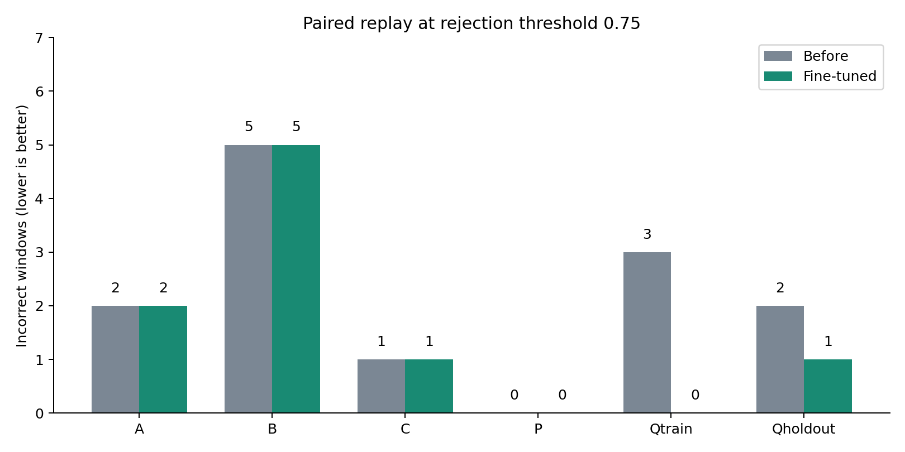

# 2026-10-19 新负样本 VideoMamba 微调与交付

已完成训练、留出测试、原镜像内运行验证，并更新默认算子和 NVIDIA Box 包。现役权重为
`videomamba_t_behavior_32f_realactall_full_pn2.pth`（pn2），从原 pn 继续训练，选中第4轮。默认仍为 **0.75**，
720处理长边、前后各2秒、骨架显示、标签同步与录制收尾修复均保留。

新训练负样本上的融合误报3→0/175；按会话留出的新负样本误报2→1/68。
已有四套件在0.75下逐窗正确/错误状态保持。**仍有误报，也仍有既有正样本漏检**；
这不是全场景零误报或全部九类动作不退化的证明。

## 交付文件

| 文件 | 大小 MiB | SHA256 |
|---|---:|---|
| [dark-demo-v2_pn2_20261019.tar.gz](../platform/dark-demo-v2_pn2_20261019.tar.gz) | 206.65 | `3f3c37c5679d3e8c779571cb6a7f365e6aacef5f9ccb492410dcd7c80b2aa78f` |
| [dark-demo-v2_pn2_20261019.zip](../platform/dark-demo-v2_pn2_20261019.zip) | 206.67 | `0cd06112bc60d589fe8540d02093b98d36362deddaee50b82e0c0e71541dfa59` |
| [NVIDIA-Box_20261019.zip](../NVIDIA-Box_20261019.zip) | 146.91 | `364d2eba78f77d74711296b649d29963bdf3753499b463dca379bce5e5bfcd25` |

默认路径 `platform/dark-demo-v2.tar.gz`、`platform/dark-demo-v2.zip`、`NVIDIA-Box.zip`
已同步为对应版本；正式源码 `platform/dark-demo-v2/` 和 `NVIDIA-Box/` 同步。
tar保留`dark-demo-v2/`外层，平台ZIP根目录直接含`main.py`和`suanzi.json`。
旁边的`.manifest.json`包含完整文件哈希；[release.json](feedback-finetune-20261019/release.json)还记录MD5、包大小与默认值。
旧pn权重、pose/feedback日期包和`NVIDIA-Box_20261018.zip`保留作回滚。

平台使用已上传的原 `darkpipe-operator:0.3.0`，**镜像无需重新上传**：

- 镜像 ID：`sha256:d359716620d7eb757cd7c36733e25642469450f1c801e0367fc99248f0a2f212`。
- 原镜像归档大小：6,796,727,259字节。
- 镜像归档 SHA256：`a562d53d7bc588aded2d146939a634cf3e0a78afd6dfb8c5f53692c6afec2b77`，与10-15记录完全相同。

本次重新读完归档计算哈希，核对实际运行镜像ID；未构建或安装新镜像依赖。
只需更新算子包；若平台仍保存旧参数清单，重新导入随包`suanzi.json`，并检查实际任务参数
`reco_min_conf=0.75`、`proc_max_side=720`、`pose_overlay=true`。没有替用户上传平台或远端盒子。

## 数据与训练

用户提供的32段视频按`other`标注，来源为`realdata-10-09/darkpipe.tar.gz`，SHA256
`24b3e223c0b1457c4925d5b94ef05f2dbae28bbe6c29875d8c99ed1af04caf87`。
归档含6个会话，共2,980帧，已全部解码检查。
视频已经过线上增强/超分/编码，统一裁掉底部66px标签条，保留1440×808图像，**不做第二次增强**。
无法恢复超分前像素或原图照度，故这部分只代表处理后视频回放。

| 用途 | 数据 |
|---|---|
| 新训练负样本 | 4个完整会话，23段、175窗 |
| 封存测试负样本 | `20261015_163555_77`与`20261019_092255_83`，9段、68窗 |
| 原训练数据回放 | 3,220个唯一窗：Other1921、挥手395、喝水385、追逐349、捡物170 |
| 合并训练缓存 | 3,395窗；新增数据另有68窗holdout |

历史文档中的6,440是重复的train/val合计，不是6,440个独立训练窗，本次已纠正说明。
合并缓存位于`/ssd1/wfs/project/lowlight/compare/behavior/cache/realact_all_rf_v1_all_pn2_20261019`，
采用硬链接，供后续只读训练使用，不应原地修改。拆分与逐视频/窗口来源见
[data-manifest.json](feedback-finetune-20261019/data-manifest.json)，没有将含摄像机凭据的原会话JSON放入交付包。

训练从pn权重继续，head学习率2e-5、backbone2e-6，AdamW、weight_decay0.05，batch8，4轮，seed19；
每轮424步，半轮warmup后cosine；20%采样质量来自新负样本，其余80%在旧数据类别间平衡。
label smoothing0.1；蒸馏系数0.2、温度2，**只约束旧数据**，避免强迫新负样本复现老师的错误。
四轮采样训练准确率为93.75%、96.20%、97.23%、96.96%，训练正常退出，未出现非有限loss。
首轮AMP动态缩放期间出现scheduler顺序告警，后续完成全部训练；最终效果按实际检查点评估。
详见[训练配置](feedback-finetune-20261019/training-config.json)、[训练历史](feedback-finetune-20261019/training-history.json)和[日志](feedback-finetune-20261019/train.log)。

选模型规则在训练前固定于[protocol.json](feedback-finetune-20261019/protocol.json)：A/C正确数不能降低，B/P误报不能增加；
通过后依次按Qtrain融合误报、RGB误报、A+C正确数、Qtrain平均具名概率及早轮优先排序。
第1轮A下降至174/177，被拒绝；第2/3/4轮通过，按固定规则选择第4轮。
**选择完成后才运行两个留出会话**，没有用留出集调阈值或重选轮次。

## 同输入配对测试（默认阈值0.75）

ABCP与新训练部分共1,195窗，留出68窗；每个候选复用部署`push`实际使用的400×224输入和
同一组骨架概率，调用实际融合/拒识函数。RGB缓存重建归一化后逐位核对。
A/B/C原始输入按720和逐帧Retinexformer处理；P/Q裁标签、不二次增强，原图照度未知时跳过照度门。

| 套件 | 内容 | 旧pn → 新pn2（融合） | 纯RGB动作误报（旧→新） |
|---|---|---:|---:|
| A | 177个已有验证窗口 | 正确175→175 | 不适用 |
| B | 365个旧Other窗口 | 误报5→5 | 5→5 |
| C | 18个已有现场正样本窗口 | 正确17→17 | 不适用 |
| P | 460个早期平台回传窗口 | 误报0→0 | 3→0 |
| Qtrain | 新23段，175窗 | 误报3→0 | 54→0 |
| Qholdout | 封存9段，68窗 | 误报2→1 | 10→5 |

留出误报窗口率2.94%→1.47%，减少1个窗口、1个视频；9段中有误报的视频2→1。
与训练部分合计的新243窗误报5→1，但不能把训练与留出混合结果当作泛化指标。
P的预处理纠正了早期评估脚本的重复增强，**只能与本轮重算的旧pn基线比较**，不应直接和旧报告P数字作前后对照。

两个留出会话中变化来自首个会话（2→1/27），第二个会话均为0/41。
重叠窗口并非独立样本，仅两个同摄像机会话、一个训练种子，无法给出可靠的总体95%区间或多种子方差。
探索性会话符号翻转仅4种排列，双侧p=1.0，不支持统计显著性或跨场景泛化结论。
详见[配对分析](feedback-finetune-20261019/analysis/analysis-report.md)、[统计口径](feedback-finetune-20261019/analysis/stats-appendix.md)、
[逐窗CSV](feedback-finetune-20261019/analysis/paired-windows.csv)和[固定阈值补充表](feedback-finetune-20261019/analysis/threshold-sensitivity.md)。

图中A/C为错误窗口数，其他套件为Other动作误报数；样本量不同，不横向比较套件难度。
[训练图](feedback-finetune-20261019/analysis/figures/02-training.png)仅描述一个种子的训练过程，不代表泛化准确率。
两图同时提供PDF，可用于汇报；确切数据在JSON/CSV中。

## 残余错误与边界

- 留出仍误报：`20261015_164746_waving_0002@t0.500`，按用户标注应为Other；
  RGB挥手0.92101→0.92127，骨架挥手0.36441未变，融合0.75403→0.75422，仍略高于0.75。
  这说明本轮新增负样本并未覆盖或修复全部相似画面。
- 已压下的留出窗口：`20261015_165117_waving_0003@t0.519`，融合挥手0.77322→0.74705，
  在0.75阈值下从挥手变为Other。
- C既有漏检仍是`挥手22@whole`；独立10样例对拍的整段窗约0.7396，两端均报Other。
  A既有错误仍为`喝水18_00040`、`挥手21_00008`；B仍有5个追逐误报。
- 现场正样本仅覆盖挥手、追逐、喝水、捡物；本轮没有投掷、跌倒、打架、交谈、握手的正样本回归，
  不能宣称全部九类动作均未退化。骨架模型、增强模型和可选三部曲没有重新训练。
- 归档只有32段已保存视频，旧11,593条事件缺少完整视频输入，无法用新模型逐条重算；
  旧日志0.75下的23次误报与本次68窗测试不是同一个统计口径。

## 独立交付验证

测试均使用原`darkpipe-operator:0.3.0`、本机RTX3090；未连接实体NVIDIA Box。
先打候选包、独立解包后运行，最终只更新说明文档并重打包，正式归档中的代码、参数、字体和权重
与已测试解包逐字节一致。正式源码、日期包和默认包均通过manifest校验。

| 验证 | 实际结果 |
|---|---|
| 算子CPU回归 | 108项通过，含收尾协议、生命周期、交付参数、骨架绘制 |
| 盒子合约回归 | 31项通过 |
| 盒子环境自检 | 8/8通过，真实增强、RGB、姿态、ST-GCN、照度门可运行 |
| 平台/盒子真实CUDA对拍 | 10/10标签一致，最大置信度差0.00024205；这是实现一致性，不是10/10识别准确率 |
| 用户点名的旧误报片段 | `20261015_181324_drinking_water_0005.mp4`整段回放两端均为Other |
| 完整离线入口 | 1080p/25fps喝水视频，75帧输入、75帧整段H.264输出，1440×874，4条喝水事件 |
| 动作片段 | 1段H.264，74帧/2.96秒（按时间轴重采样，与元数据一致），完整解码；含候选人物骨架 |
| 收尾状态 | 正常退出0、session=finished；丢帧/放弃/强制释放/写入失败/未完成片段均0 |
| 镜像与旧权重 | 镜像ID及归档哈希未变；平台旧7份、盒子旧6份权重字节不变，仅新增pn2 |

[10样例对拍结果](feedback-finetune-20261019/delivery-verification/result.json)、[平台108项日志](feedback-finetune-20261019/cpu-regression.log)、
[盒子31项日志](feedback-finetune-20261019/box-cpu-regression.log)、[环境自检](feedback-finetune-20261019/box-check-env.log)、
[完整离线验证](feedback-finetune-20261019/real-offline/verification.json)。
可直接观看[完整示例视频](feedback-finetune-20261019/real-offline/delivered/喝水16/20261019_145604_1/喝水16-处理后.mp4)。

片段前后2秒的设定保留；3秒输入不能凭空产生5秒上下文。骨架仍须积累识别窗口后才出现，
此例首事件0.96秒，符合原逻辑。
本轮未做实时性能测试或长时间平台稳定性验收；短离线日志的3.06fps包含该功能运行负载，
不作为默认三卡实时基准。既有速度未达标问题没有在本轮解决，也不保证外部故障不会中断。

## 权重、复现与回滚

| 对象 | SHA256 |
|---|---|
| 原pn | `31ee8a11fdd21a7fd5b969d030e774a608559a45f9cc2351689f444014176b04` |
| 新pn2（epoch-04） | `d30b36c4c1ca9ab276442b4d0544b3d705f4ead68c7dcb5a721b696f9ee5f362` |

新权重同时保存到平台`ckpts/`、盒子`weights/`与仓库根`ckpts/`；根开发管线的默认模型未改。
按[RUNBOOK.md](feedback-finetune-20261019/RUNBOOK.md)复现，全部训练/回放脚本在[scripts/](feedback-finetune-20261019/scripts)，
四轮检查点保留在[checkpoints/](feedback-finetune-20261019/checkpoints)。重跑应使用新的实验目录，不覆盖本轮证据。

回滚模型：平台将`darkpipe/constants.py`的`CKPT_FILES["behavior"]`改回旧pn文件名并重新打包；
盒子可用`--weights weights/videomamba_t_behavior_32f_realactall_full_pn.pth`。
这会保留当前0.75阈值和工程修复；直接使用10-18旧盒子ZIP会同时恢复当时0.65阈值，应区分两者。
