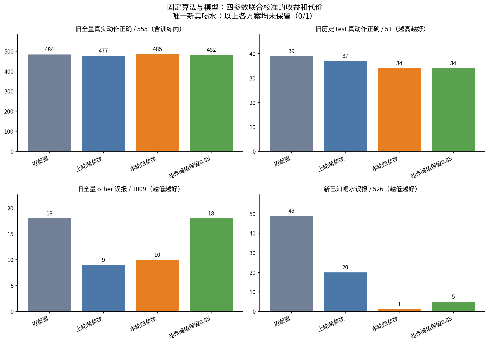
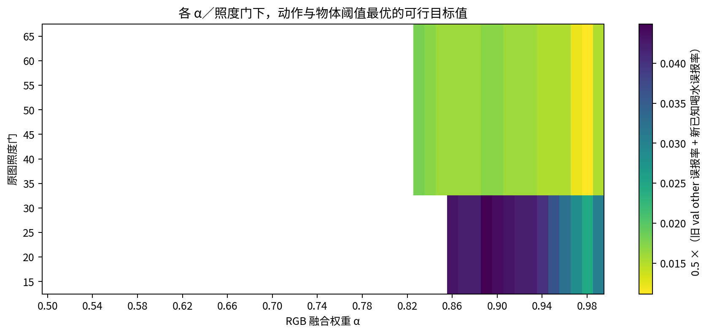
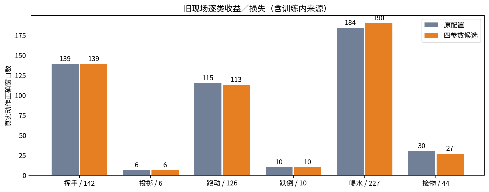

# 四参数联合调优：固定算法与模型

候选：RGB 权重 **0.972**、原图照度门 **35**、动作阈值 **0.925**、物体阈值 **0.581**。离线实验候选，未替换生产包、模型、镜像或默认参数。

| 方案 | α / 门 / 动作 / 物体 | 旧真动作 /555 | 旧other误报 /1009 | 新已知喝水误报 /526 | 新真喝水 /1 |
|---|---|---:|---:|---:|---:|
|原配置|0.950 / 30 / 0.850 / 0.350|484|18|49|0|
|上轮两参数|0.950 / 30 / 0.905 / 0.358|477|9|20|0|
|本轮四参数|0.972 / 35 / 0.925 / 0.581|485|10|1|0|
|动作阈值保留0.85|0.900 / 35 / 0.850 / 0.590|482|18|5|0|

配对变化：旧真实动作损失 21 窗、新增正确 22 窗；旧other纠正 10 个、新增误报 2 个。窗口不是完整动作事件数或保存片段数。旧全量净增不能掩盖历史test的损失，本候选只适合表述为“误报优先的校准候选”，不是全面胜出。

在本轮网格与旧val逐类保护等约束下，没有找到同时保留唯一新真喝水的可行组合。该窗兼容瓶/杯证据最高仅0.012022；降低物体阈值可以放过它，但不能在当前约束下同时守住其他指标。这不能推导为所有未来场景均无法兼顾。

| 旧现场拆分 | 真动作正确（原→候选） | other误报（原→候选） |
|---|---|---|
|train|422→426/468|7→5/730|
|val|23→25/36|6→3/162|
|test|39→34/51|5→2/117|

逐类旧现场正确数：挥手 139→139/142；投掷 6→6/6；跑动 115→113/126；跌倒 10→10/10；喝水 184→190/227；捡物 30→27/44。

新场景其他类别没有逐窗真值，以下仅为触发量：挥手 115→35；跑动 64→19；捡物 0→0。不能把减少量全部称为纠错。

粗扫 1,485,000 组，细扫 101,871 组（有少量重叠）；α粗步长.01，动作/物体粗步长.01；局部细步长.001。主搜索照度门 [15, 20, 25, 30, 35, 40, 45, 50, 55, 60, 65]，每5单位。70/75因新现场存在低于门限的单帧，未放入联合排名；旧现场仍完成这两档的跟踪/骨架诊断。千分位最优只反映当前样本，不是跨场景精确最优。

门35–65在主候选的校准目标及逐类val指标上同分，因此按预定“更接近原配置”的规则选35；这不证明35是唯一最佳亮度分界，也不把test表现用于打破平局。

新增正确的22个旧真实动作窗全部位于30≤L<35。门提高后，这些窗转为纯RGB且跳过物体先验，因此获得恢复；这不代表模型本身识别能力提高，也不能抵消亮场test的退化。

目标：旧val other误报率与新526已知喝水误报率等权。约束从搜索前冻结：旧val每个有标签动作的TP不低于基线、旧val/历史线上val/新已知误报不增加、新未审核喝水不增加，动作阈值不直接压掉唯一新真喝水。选参函数不读取旧train/test指标。

544来源、51,834窗。151个受门影响的旧来源按生产跟踪器独立回放；13档轨迹和裁剪全部对齐，908个受影响gate30窗口的RGB/骨架概率复现。新9段80,316原帧逐一计算亮度，与全部47,600窗口亮度均值精确对齐；主搜索各门的逐帧骨架掩码一致。新执行 13,861 帧旧源增强，以及 851 次新增物体裁剪推理，物体分数保留至.001。其余同像素、同模型缓存按哈希复用。

算法保持：现场微调YOLO26m人体与物体模型、RTMO-s、VideoMamba、历史现场ST-GCN，以及公开NTIRE增强；720增强图同人裁剪，5帧中任一帧有兼容物体即可。原图窗口/采样照度门共同约束物体先验。没有改成连续证据规则、类别专用阈值或新模型。

证据关联沿用前轮：旧视频使用精确逐帧轨迹；新已知候选复用冻结ROI，新补候选取同人最近事件（≤0.55秒）并重新推理姿态，框IoU>0.4歧义时弃权。这是离线近似绑定，不等同于已集成生产逐帧物体先验。

限制：旧全量含训练数据，历史test已多次查看；新9段现在是用户反馈校准集，不能称独立泛化验收。新仅527个既有喝水触发有二元标签：1真526假；not_drink不等于所有动作other。捡物“基本全误报”没有逐窗标注。71个旧来源无动作窗（含漏检/未成窗），不计正确；525个旧现场未知窗不计准确率。历史线上128来源2145窗亮度未知，物体先验弃权，单列统计。

校验：51,834基线窗决策复现，132组累积搜索与逐窗暴力结果对照，259,170次正式融合策略对照，60,192次正式物体规则对照；9项物体先验CPU回归通过。不是实时速度/推流/保存验收。

文件：[逐窗结果](window-results.csv)、[已知得失](known-changes.csv)、[全部来源](video-results.csv)、[参数预设](recommended-settings.json)、[选参锁](selection-lock.json)、[验证](verification.json)、[统计附录](stats-appendix.md)。

