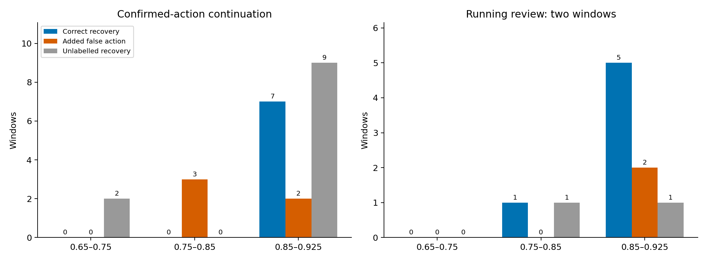
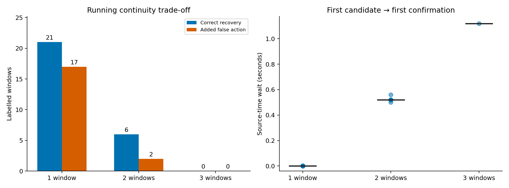

# 低分候选补报实验

续接合计补回7个真实窗口、新增5个已知误报窗口；双窗口跑动补回6个真实窗口、新增2个已知误报窗口。两项联合为10个真补回、7个新增误报，存在重合，不能把两项直接相加。

本轮只验证，不改正式模型、阈值、平台/Box代码、交付包或镜像。当前阈值仍为0.925。正式模型未使用10/30的85正例候选微调权重。本实验在原正式概率上因果回放，补算缺失的精确同人物体/骨架证据。

## 三档结果

下表单位是**人物动作窗口**，相邻窗口会重叠，不等于独立动作次数。误报包含other报动作及真动作报错类别；未标注恢复不计TP/FP，也不能视作正确。区间左闭右开，但0.65本身排除；0.925及以上沿用原规则。

|候选置信度|规则|补回真动作窗|新增误报窗（other／错类）|恢复但未标注窗|首次确认等待|
|---|---|---:|---:|---:|---|
|0.65–0.75|已确认动作续接|0|0（0／0）|2|0秒（无需等待未来窗口）|
|0.65–0.75|跑动双窗口复核|0|0（0／0）|0|—（无新确认）|
|0.65–0.75|两项联合|0|0（0／0）|2|—（无新确认）|
|0.75–0.85|已确认动作续接|0|3（3／0）|0|0秒（无需等待未来窗口）|
|0.75–0.85|跑动双窗口复核|1|0（0／0）|1|0.52秒中位，0.52–0.52秒|
|0.75–0.85|两项联合|1|3（3／0）|1|0.52秒中位，0.52–0.52秒|
|0.85–0.925|已确认动作续接|7|2（2／0）|9|0秒（无需等待未来窗口）|
|0.85–0.925|跑动双窗口复核|5|2（2／0）|1|0.52秒中位，0.50–0.56秒|
|0.85–0.925|两项联合|9|4（4／0）|10|0.52秒中位，0.52–0.56秒|

首次确认等待按本次发生确认的窗口置信度归档；完整候选链可跨档，未要求全链都在同一置信区间。跑动第一次候选不会回填成已识别结果，达到条件的当前窗口才输出。后续连续合格窗口不再额外等待。续接等待0仅指不等未来帧；不代表CPU/GPU处理和端到端延迟为0。

## 数据范围与事件组

全流51,834窗口（旧4,234＋新九段47,600），有标签4,445窗：旧3,709＋新人工736（85正例、651other）。其余47,389窗保留用于时序回放/未知结果统计，未把预测other当真值。此前排除的实体、冲突及不确定窗口仍无评分标签。新九段均为历史反馈录像，旧train/val/test也已多轮查看；不是全新盲测。

|数据范围|有标签窗（正类窗）|规则|补回真窗|新增误报窗|原本漏掉、现补回的动作组|新增other报警组|
|---|---:|---|---:|---:|---:|---:|
|旧训练回归|3297（468）|已确认动作续接|0|3|0|1|
|旧训练回归|3297（468）|跑动双窗口复核|0|0|0|0|
|旧训练回归|3297（468）|两项联合|0|3|0|1|
|旧验证回归|198（36）|已确认动作续接|0|0|0|0|
|旧验证回归|198（36）|跑动双窗口复核|0|0|0|0|
|旧验证回归|198（36）|两项联合|0|0|0|0|
|旧测试回归|214（51）|已确认动作续接|2|0|0|0|
|旧测试回归|214（51）|跑动双窗口复核|1|0|0|0|
|旧测试回归|214（51）|两项联合|2|0|0|0|
|新多人反馈|736（85）|已确认动作续接|5|2|0|0|
|新多人反馈|736（85）|跑动双窗口复核|5|2|3|2|
|新多人反馈|736（85）|两项联合|8|4|3|2|

新多人事件组沿用上传审核ID；旧组按同源、人物/代次、同真值及相邻窗口≤0.65秒形成连续组。已被基线识别过的组新增正确窗口，只算补全时段，不算救回整段漏检。group any-trigger不等于完整保存时长，也不测片段边界。

## 固定规则与验证

正式alpha0.972、照度门35、动作阈值0.925、物体阈值0.581、挥手3帧、跑动速度0.35人体框高/秒保持。续接要求同人同代次、同最高分动作、最近正式高分锚点≤1.2秒、相邻输出≤0.65秒；other/换类/先验否决/断档清空，低分续接不能刷新高分锚点。当前候选重新满足原先验；在低亮、证据缺失或全歧义时不凭“跳过先验”主动补报。无既定先验的类别只用续接条件。

跑动主实验要求0.65<置信度<0.925、亮度≥35、可靠同人速度≥0.35，两个连续窗口且尾帧跨度≥0.5秒。失败/换类/高分原确认/断档重置。单窗口及三窗口≥1秒仅预声明诊断，不事后改选测试最优设置。

|跑动复核|真实补回窗|新增误报窗|未标注恢复窗|首次确认等待中位|
|---|---:|---:|---:|---:|
|跑动单窗口（诊断）|21|17|11|0.00秒|
|跑动双窗口复核|6|2|2|0.52秒|
|跑动三窗口（诊断）|0|0|1|1.12秒|

旧窗口使用当前推理对应的检测框和骨架，未使用外扩RGB裁剪框作速度分母。新窗口优先复用严格同源、人物、代次和帧号匹配的原像素特征；缺少的430窗从原片开头完整重放前端、校验人物/代次/尾框/32采样帧。物体按当前720增强裁剪流程，复用125份精确特征证据并补算101份；没有最近时间窗口替代。

旧4234个基线标签与历史正式结果差异0。另对736个人工多人窗口的10/30基线作交叉核对，见verification.json；若浮点/证据差异存在会逐条记录。882个前缀因果检查通过，11项状态机边界测试通过。未用未来帧、未跨人物/代次续接。

## 结论的边界

本轮测的是**固定历史流的决策与新增时间等待**，没有再次跑动作模型，也没有测新增物体计算接入实时系统后的排队、端到端推流延迟或算子吞吐。补算任务并行共享主机，因此其耗时不能当独占性能基准。未知标签的恢复数已单列，零已知误报不等于线上零风险；正例少时尤其不能作保证。

[逐窗结果](window-results.csv)、[分档表](summary.csv)、[事件组](event-groups.json)、[按源变化](source-effects.json)、[冻结协议](protocol.json)、[审计](verification.json)可复查。preliminary-invalid目录为已作废初稿，全部数字排除。
