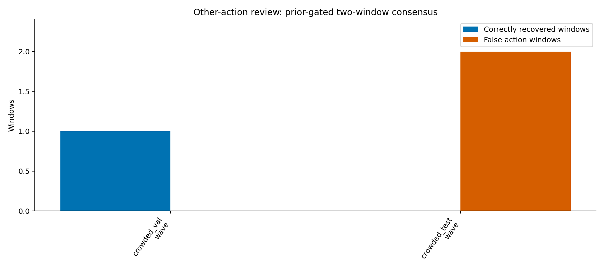

# 其他动作低置信度复核实验

## 结论

只接受“同类候选连续出现”并不足以作为低阈值动作复核。以下数字按动作窗口统计，事件组另列；未标注数据不当作真例或误报。

### 总体结果

主评估共有308个旧／多人验证与测试候选窗口。

- 二窗纯连续：真动作窗口 2、误报窗口 103、未标注 0；新增检出动作组 2、新增误报组 57。
- 二窗连续＋动作先验：真动作窗口 1、误报窗口 2、未标注 0；新增检出动作组 1、新增误报组 1。
- 三窗连续＋动作先验：真动作窗口 0、误报窗口 0、未标注 0；新增检出动作组 0、新增误报组 0。

|数据组|规则|真实动作窗口补回|误报窗口|未标注窗口|新增检出动作组|新增误报组|确认延迟中位数|
|---|---|---:|---:|---:|---:|---:|---:|
|old_val|二窗纯连续|0|0|0|0|0|—|
|old_val|二窗连续＋动作先验|0|0|0|0|0|—|
|old_val|三窗连续＋动作先验|0|0|0|0|0|—|
|old_test|二窗纯连续|1|0|0|1|0|0.50秒|
|old_test|二窗连续＋动作先验|0|0|0|0|0|—|
|old_test|三窗连续＋动作先验|0|0|0|0|0|—|
|crowded_val|二窗纯连续|1|25|0|1|15|0.52秒|
|crowded_val|二窗连续＋动作先验|1|0|0|1|0|0.52秒|
|crowded_val|三窗连续＋动作先验|0|0|0|0|0|—|
|crowded_test|二窗纯连续|0|78|0|0|42|0.52秒|
|crowded_test|二窗连续＋动作先验|0|2|0|0|1|0.52秒|
|crowded_test|三窗连续＋动作先验|0|0|0|0|0|—|

二窗需要≥0.5秒，三窗需要≥1.0秒；等待从该连续候选第一次出现算到首次确认，主评估确认等待中位数约0.52秒。后续窗口不重复计新增延迟。独立候选必须每窗满足相应先验：挥手使用三帧腕高于双肩；喝水／捡拾使用当前物体模型、阈值0.581且遵守亮度门35。没有专属先验的动作只展示模型连续性对照，不据此建议启用。

### 按动作观察

- 挥手（55个留出候选）：纯二窗 1真／9误报；二窗加先验 1真／2误报；三窗加先验 0真／0误报。
- 喝水（220个留出候选）：纯二窗 1真／86误报；二窗加先验 0真／0误报；三窗加先验 0真／0误报。
- 捡拾（27个留出候选）：纯二窗 0真／8误报；二窗加先验 0真／0误报；三窗加先验 0真／0误报。
- 抛物（1个留出候选）：纯二窗 0真／0误报；二窗加先验 0真／0误报；三窗加先验 0真／0误报。
- 摔倒（5个留出候选）：纯二窗 0真／0误报；二窗加先验 0真／0误报；三窗加先验 0真／0误报。
- 交谈：留出集中没有符合置信度范围的候选，无法评估。
- 打架：留出集中没有符合置信度范围的候选，无法评估。
- 握手：留出集中没有符合置信度范围的候选，无法评估。

纯二窗规则补回的2个真动作窗口分别是一个旧测试喝水和一个多人验证挥手；加先验后保留挥手、否决了未获物体支持的真实喝水。多人测试仍剩2个挥手误报窗口；三窗规则将误报清零，但也没有补回真动作。喝水／捡拾门控大幅压制误报，但本轮不能证明保持召回，尤其真实喝水漏过这一例需要后续专门复核。

### 按动作和置信度

CSV [action-summary.csv](action-summary.csv) 给出逐组逐动作统计；[score-bin-summary.csv](score-bin-summary.csv) 再按0.65–0.75、0.75–0.85、0.85–0.925三档拆分真实补回、误报、未标注和候选覆盖。全量逐窗证据在 [window-results.csv](window-results.csv)。

## 数据和验证范围

使用原正式模型的冻结融合概率，正式α=.972、照度门35、动作阈值.925、物体阈值.581、挥手3帧、跑动.35不变。全量共有1096个0.65–0.925非其他候选；排除跑动后为1005个，类别分布`{'pick_up': 84, 'drink': 741, 'wave': 155, 'fall': 14, 'throw': 11}`。本轮实际有留出候选的是挥手、喝水、捡拾、抛物和摔倒；交谈、打架、握手没有符合范围的留出候选，不能据此评价。置信度分档为(0.65,0.75)、[0.75,0.85)、[0.85,0.925)。主结果只纳入旧验证／测试和多人验证／测试；训练组只作诊断。多人13个窗口真值按用户确认更新。

低分喝水／捡拾候选序列中，held-out范围有147个窗口需要精确物体证据，其中新补算145个、复用2个精确帧匹配结果；共2个窗口找到满足类别、置信度与人物ROI条件的单帧物体证据。新证据按同一人物、代次、源帧和720增强裁剪生成。挥手直接复用同窗精确骨架。没有用预测other、缺失先验或跨时刻近邻补标签。

所有旧/新split仍曾用于历史调参或人工回看，不是全新盲测；窗口相互重叠。样本不足的类别只报告候选/标签覆盖，不作有效性结论。该回放没有更改平台、Box、模型、参数、算子包或镜像，也未测试在线队列、端到端延迟或片段保存。

规则定义与审计见 [protocol.json](protocol.json)、[verification.json](verification.json)、[按动作汇总](action-summary.csv)、[按置信度分档汇总](score-bin-summary.csv)、[逐窗表](window-results.csv) 和 [动作组表](event-results.json)。
