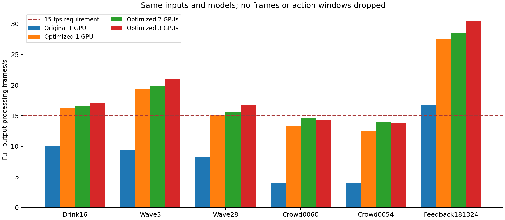
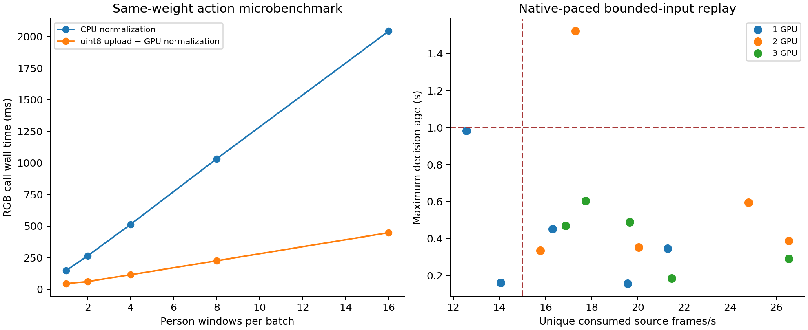

# 逐人方案工程优化与验证（2026-10-23）

## 结论

工程优化显著改善了速度，当前没有证据要求立刻把现有VideoMamba换成轻量模型。
但不同人数、输入链和卡数的结果不同，不能宣称所有配置全面达标。

- 单卡：全帧处理的原始视频从8.33–10.11fps提升至约15–19fps；实时双人挥手通过，亮场三候选样本只有14.07个新帧/秒，尚未全面满足15fps。
- 双卡：适合本轮少人原始视频及四/八候选回传场景；极拥挤样本虽然画面17.30fps，仍有动作积压、74个待处理窗口合并，最大决策时延1.522秒，未达标。
- 三卡：一张前端卡、两张动作卡，动作卡采用独立进程。30秒拥挤回放17.73个新帧/秒、453/453个已提交窗口完成、最大决策时延0.605秒，短测通过。
- 三卡并非普遍比双卡快：八候选回传三卡19.65fps低于双卡24.80fps，跨进程复制和调度有成本，不能按卡数线性推算。
- 拥挤和四/八候选视频均为已增强回传片段，不重复增强。**没有原始拥挤视频的完整增强链实测，不能把这些数字外推为原始多人监控的验收成绩。**

本轮保持原权重、32帧400×224输入、每人约0.5秒更新、α0.7、动作阈值0.75、原图照度门75，未启用物体先验、未降频人体检测/姿态、未训练轻量模型。
这是独立逐人候选运行程序，未替换平台入口、生产权重、Box包或镜像；多人事件/片段的生产集成仍需独立实施和验收。
本轮原始视频链包括Retinexformer增强、人体/姿态检测、逐人动作融合、绘制及H.264编码；未包含平台的全部后处理、事件落盘和网络推流。

## 实际改动

1. 以固定pinned memory缓冲上传uint8人物图像，GPU执行与原实现相同的float32归一化；RGB仍使用原有FP16 autocast。
2. GPU缓存逐帧归一化ROI，键包含会话、人物ID、历史代次和源帧号。复用重叠时间窗及重复采样帧，LRU限定512帧，不复用VideoMamba隐藏状态。
3. 动态处理已到期人物窗口，单卡每批最多2人，多卡最多4人；不等待凑满批次，每批完成即发布。1/2/4/8/16批量微测显示大批吞吐增益趋于饱和，因此没有默认堆到16人。
4. CPU解码/缩放、GPU计算、CPU绘制/编码分工；各GPU只有一个推理提交者。单卡受控执行；多卡支持线程和独立进程两种后端。
5. 最新帧模式保留真实源帧索引和时间戳，输入队列只有一格；同一人物尚未开始的旧窗口可被新窗口替换，替换数量明确统计。旧代次/旧时间结果不会覆盖新人物结果。
6. 超过1秒的显示结果失效并显示“识别中”，不会将未完成计算伪装成other；已完成但低于0.75的具名动作仍显示“其他”。
7. 图像哈希等诊断默认关闭，验证模式可启用；H.264编码仍使用原libx264，尚未将NVENC或TensorRT收益计入。

入口：[run_demo.py](scripts/run_demo.py)。核心：[action_engine.py](scripts/action_engine.py)、[scheduling.py](scripts/scheduling.py)、[runtime.py](scripts/runtime.py)、[process_pool.py](scripts/process_pool.py)。

## 动作分支瓶颈证据

在16个真实验证集人物窗口上，每个batch设置两次热身、三次计时：

| RGB批量 | 原CPU归一化路径 | uint8上传＋GPU归一化 | 新路径窗口吞吐 |
|---:|---:|---:|---:|
| 1 | 147.96ms | 45.06ms | 22.2窗/秒 |
| 2 | 264.72ms | 60.89ms | 32.8窗/秒 |
| 4 | 514.27ms | 115.11ms | 34.8窗/秒 |
| 8 | 1032.96ms | 225.60ms | 35.5窗/秒 |
| 16 | 2043.40ms | 447.87ms | 35.7窗/秒 |

batch4原路径中CPU归一化约366ms，RGB前向/回读约100ms。只把所有动作调用耗时当作VideoMamba核函数耗时会误判瓶颈。
同一batch下微测概率逐位一致；完整GPU缓存与变批量后的小幅数值差另做回归见后文。
数据量从float32变uint8减少4倍不等于模型前向加速4倍；完整链仍有增强、检测、姿态、跟踪、编码及调度成本。

## 不丢帧、不合并窗口的全帧对照

每个样本、每个后端配置预热后3次计时，包含解码、模型、绘制、编码收尾，排空动作任务。表为均值±样本标准差。
双卡选线程后端、三卡选进程后端；两种后端的完整结果都保留在summary.json，不隐藏效果较差的配置。

| 样本 | 原串行单卡fps | 优化单卡fps | 优化双卡fps | 优化三卡fps |
|---|---:|---:|---:|---:|
| 喝水16 | 10.11 | 16.31±0.54 | 16.65±0.06 | 17.09±0.22 |
| 挥手3 | 9.34 | 19.41±0.18 | 19.84±0.30 | 21.05±0.11 |
| 留出_挥手28 | 8.33 | 15.17±0.13 | 15.55±0.53 | 16.79±0.14 |
| 多人0060 | 4.09 | 13.40±0.09 | 14.59±0.61 | 14.34±0.85 |
| 多人0054 | 3.94 | 12.48±0.33 | 13.98±0.72 | 13.81±0.54 |
| 回传留出_181324 | 16.82 | 27.47±1.38 | 28.60±1.11 | 30.49±0.18 |

该表的拥挤场景仍未稳定超过15fps。后面的实时表是限长输入队列、会丢源帧的另一种运行方式，不能混成同一成绩。
原视频含增强；回传片段不重复增强。短片约1秒观测窗预填阶段尚未产生动作负载，整段吞吐偏乐观。

## 原帧率实时回放

源端按25/27/29/30fps独立供帧，消费者不让源降速；输入过载时覆盖尚未处理的旧帧。
这里fps=实际消费的不同源帧数/源时间，**不把重复输出帧算作处理帧**。
“最新帧→决策”截止动作worker计算完成，包含前端及任务排队和模型计算，不包含结果返回后的绘制、推流、播放器延迟，也不包含约1秒观测窗预填；它不是动作起点到识别的延迟。
四/八候选片段各20秒，其余各30秒，均由短片循环；每次跨片重置人物历史，避免把视频尾首拼成假动作。

| 样本 | GPU数 | 新帧fps | 决策P95/最大(s) | 完成/提交人物窗 | 丢源帧/源总帧 |
|---|---:|---:|---:|---:|---:|
| 多人0060 | 1 | 12.57 | 0.815/0.983 | 345/375 | 493/870 |
| 挥手3 | 1 | 19.57 | 0.148/0.157 | 102/102 | 163/750 |
| 留出_挥手28 | 1 | 14.07 | 0.155/0.161 | 109/109 | 478/900 |
| 多人0060 | 2 | 17.30 | 1.335/1.522 | 319/393 | 351/870 |
| 挥手3 | 2 | 20.03 | 0.334/0.353 | 102/102 | 149/750 |
| 留出_挥手28 | 2 | 15.77 | 0.285/0.336 | 111/111 | 427/900 |
| 多人0060 | 3 | 17.73 | 0.468/0.605 | 453/453 | 338/870 |
| 挥手3 | 3 | 21.47 | 0.172/0.185 | 102/102 | 106/750 |
| 留出_挥手28 | 3 | 16.87 | 0.173/0.469 | 102/102 | 394/900 |
| 八候选0118 | 1 | 16.30 | 0.417/0.452 | 273/273 | 274/600 |
| 四候选0047 | 1 | 21.30 | 0.247/0.347 | 134/134 | 114/540 |
| 八候选0118 | 2 | 24.80 | 0.550/0.595 | 273/273 | 104/600 |
| 四候选0047 | 2 | 26.55 | 0.387/0.389 | 134/134 | 9/540 |
| 八候选0118 | 3 | 19.65 | 0.455/0.491 | 273/273 | 207/600 |
| 四候选0047 | 3 | 26.55 | 0.274/0.291 | 134/134 | 9/540 |

该表仅统计可组成有效观测窗的人物任务，不能解释为所有进入画面的人都立即得到动作类别。
跟踪丢失、原片很短、跨片预填、首次结果等待都会影响人物可视化覆盖率；逐人发布间隔和具有有效观测窗时的显示覆盖率在live-summary.json中完整列出。
三卡拥挤样本的逐人发布间隔P95/最大约0.575/0.643秒，未做到严格每0.5秒更新；0.5秒是源时间触发目标，实际帧间隔和执行时间会造成偏差。
该样本具备有效观测窗的人物帧中，约73.4%显示了尚未过期的识别结果，其余主要受首次结果等待、跨片重置和轨迹变化影响。453/453完成不代表画面中的每个人始终都有动作标签。
实时丢源帧改变观测采样，不能借用下面204窗的等价回归声称整个实时系统精度完全不变。拥挤0060这次所有已完成结果为other，但不构成新的泛化或漏检证明。

## 持续运行检查

- 八候选0118：输入300秒，实际23.50新帧/秒，决策P95/最大0.369/0.479秒，完成4133/4133窗口，超过1秒0条，丢弃过时源帧1951/9000，最多9个人体候选。
- 长现场_挥手：输入300秒，实际22.25新帧/秒，决策P95/最大0.173/0.220秒，完成533/533窗口，超过1秒0条，丢弃过时源帧826/7500，最多2个人体候选。

同一三卡进程连续处理两种输入，各300秒；短视频循环，跨片边界重置跟踪。它是本地混合负载稳定性测试，不是连续10分钟天然长镜头，也不是平台RTSP验收。

## 正确性与误差

- 204个既有逐人测试窗全部回放，RGB类别、融合类别和分支模式0变化。
- RGB宏F1 0.8373、other误报6/154；融合宏F1 0.8200、other误报1/154，均与原候选一致。
- 最大RGB/融合概率绝对差0.002251/0.001517，来自批次/数值执行差异，本次没有跨过决策阈值。
- 138段输出完整解码，共11247帧，2737条逐人事件；类别、分支、源帧和轨迹均与原演示一致。18段诊断回放还逐条核对裁剪哈希。
- 另17段实时/持续回放共21087帧完整解码，7632条结果通过帧数和任务数守恒核对；这项检查不代表丢帧后分类精度等价。
- 7项CPU回归通过，覆盖缓存淘汰时不覆盖当前批、跨人/跨代次隔离、过载合并公平性、旧结果拒收、停止时失败传播和输入源不随消费者降速。
- 未更改模型权重，不需要重新训练；本轮未进行平台容器、网络推拉流或片段上传验收。

## 是否需要轻量化模型

**暂不启动模型轻量化训练。** 本轮证明了原来的大部分动作调用开销可以通过工程方式削减，而且三卡在已测短实时场景中保留原模型即可达到帧率和最新窗口帧时延目标。

若部署要求是单卡覆盖所有亮度和十几人场景，当前仍不够，轻量化可作为下一阶段候选；但先继续细分前端的人体/姿态关联、跟踪裁剪、跨进程数据复制成本。
现有增强＋YOLO＋RTMO本身也占大量时间，只缩小VideoMamba不能保证完整原始视频链达标。
后续先用实际平台配额和较长的原始多人视频验证容量；若动作GPU仍持续满载、逐人窗口处理率不足，再训练更少帧/更小输入的学生模型并单独检验喝水召回与other误报。
