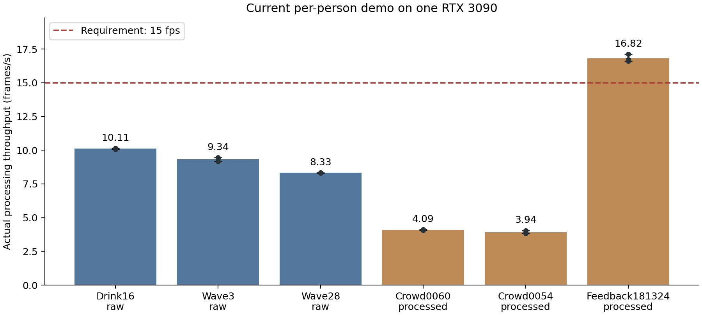
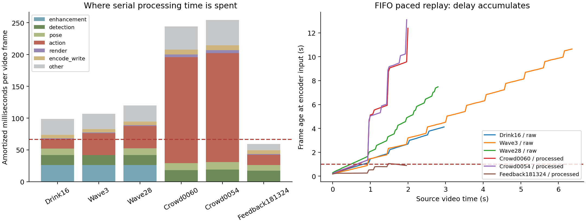

# 逐人方案性能核验（2026-10-23）

## 裁决与适用范围

**当前独立逐人实现不能作为满足“≥15 fps、识别时延≤1秒”的方案交付。**
这是本机单张RTX3090上的实测；尚未把逐人方案接入平台多卡服务，不能据此宣称多卡也必然失败或已经达标。
本次沿用用户裁定：暂不使用物体检测先验；YOLO仍负责人体框定位。

## 固定配置与测量方法

- 最新逐人微调epoch-07，SHA256 `1077cd7d25351607d89fb5cce60b0924be9fb03cbb2045b3e27ce396af2771bf`。
- RTX3090 24GB物理GPU2（CUDA可见编号0）；测前空闲，GPU0/1有其他任务，因此主机CPU/内存总线并非完全独占。
- 处理长边720，RGB每人32帧400×224，batch=2；每个人约每0.5秒识别一次，原图照度门75，α=0.7，阈值0.75。
- 原视频照常增强，再检测/姿态/跟踪/逐人RGB与骨架融合/绘制/H.264落盘；回传片段裁旧标签条且不重复增强。
- 直接调用原 `demo.run_sample()`，计时封装不改变模型、跟踪、采样、预测或输出。两次完整预热组合（喝水16＋多人0060），之后每段三次交错复测。
- 初始化 9.80 秒单独记录；正式吞吐包含解码、计算、绘制、编码收尾及原演示调试输出，不包含模型加载。
- 实际处理fps=处理帧数/墙钟耗时。保存MP4的25/29/30 fps是播放帧率，不是算法速度。
- 每段另做一次原视频帧率的FIFO节奏回放：按 `t0+frame_index/fps` 定义到达时刻，处理慢时不丢帧、不让源降速；这是本地排队模拟，不是RTSP/平台端到端测量。

## 三次吞吐实测

| 视频 | 输入链 | 候选人体数中位/最大 | fps均值±样本SD | 三次范围 | 仅三项计算的最乐观fps* |
|---|---|---:|---:|---:|---:|
| 喝水16 | 原视频＋增强 | 1/1 | 10.11±0.05 | 10.06–10.15 | 11.77 |
| 挥手3 | 原视频＋增强 | 2/3 | 9.34±0.16 | 9.16–9.47 | 10.76 |
| 留出_挥手28 | 原视频＋增强 | 3/3 | 8.33±0.02 | 8.31–8.34 | 9.48 |
| 多人0060 | 已增强回传 | 15/16 | 4.09±0.04 | 4.06–4.13 | 4.78 |
| 多人0054 | 已增强回传 | 15/16 | 3.94±0.11 | 3.84–4.05 | 4.73 |
| 回传留出_181324 | 已增强回传 | 2/3 | 16.82±0.27 | 16.61–17.12 | 23.40 |

*只累计原程序preprocess、detection_pose、person_actions耗时，剔除解码、跟踪、绘制、编码和其他成本，再取三轮最高值。
这是当前串行实现的乐观上界估计，**不是另一种实现的实测fps**。
人体数是检测/跟踪的候选数量，可能含重复框或误检，不等同于真实人数。
六段视频为代表性负载，未对完整数据集做性能分布统计；短片约1秒的历史预填期间尚未执行动作识别，会使整段平均吞吐偏乐观。

图中点是三次实测、误差棒为最小至最大值。原视频与回传片段处理链不同，不可直接把两组差异都归因于人数。
原视频与拥挤回传样本均未达到15 fps；少人数的回传短片若达到15 fps，只能说明这一段较轻负载通过吞吐项。

## 时延与积压

| 视频 | 一次动作调用耗时P95/最大(s) | 最新输入帧→决策P95/最大(s) | ≤1秒的逐人决策数 | 末帧送编码器时年龄(s) |
|---|---:|---:|---:|---:|
| 喝水16 | 0.302/0.316 | 3.65/3.76 | 0/4 | 4.12 |
| 挥手3 | 0.534/0.545 | 10.44/10.49 | 0/22 | 10.64 |
| 留出_挥手28 | 0.292/0.316 | 7.19/7.38 | 0/11 | 7.48 |
| 多人0060 | 3.132/3.239 | 12.36/12.36 | 0/38 | 12.39 |
| 多人0054 | 3.300/3.356 | 13.08/13.08 | 0/41 | 13.10 |
| 回传留出_181324 | 0.274/0.275 | 1.02/1.05 | 2/3 | 0.89 |

动作调用耗时来自三轮无节奏吞吐测试，一次调用处理该帧上所有到期的人（内部每批2人）；不是单个人时延。
决策时延来自一次节奏回放，按每条逐人输出统计，包含增强、检测、处理和排队，**不含前面收集约1秒观测窗的时间**。
同一批多人结果有相同完成时间，样本并不独立；P95只是描述性分位数，不是长期服务SLA保证。
更严格的“动作开始→识别”没有逐帧动作起始真值，本次不能验证；最老观测帧时延、首个结果到达时刻保存在summary.json。
编码器输入时间也不是远端播放器显示时间，实际网络/播放还会增加开销。

## 主要耗时（毫秒/视频帧，三轮合并平均）

| 视频 | 增强 | 人体检测 | 姿态 | 逐人动作 | 绘制 | 写编码器 | 其他 |
|---|---:|---:|---:|---:|---:|---:|---:|
| 喝水16 | 26.3 | 15.9 | 10.0 | 14.7 | 1.2 | 5.6 | 25.2 |
| 挥手3 | 26.2 | 15.8 | 0.0 | 34.5 | 1.3 | 5.0 | 24.3 |
| 留出_挥手28 | 26.3 | 15.8 | 10.7 | 34.9 | 1.3 | 5.5 | 25.6 |
| 多人0060 | 0.0 | 18.0 | 11.2 | 166.9 | 4.2 | 7.7 | 36.4 |
| 多人0054 | 0.0 | 19.0 | 11.9 | 171.5 | 4.5 | 7.7 | 39.7 |
| 回传留出_181324 | 0.0 | 17.4 | 8.9 | 15.9 | 1.2 | 6.0 | 10.0 |

“其他”包含解码、缩放、跟踪/裁剪、调试输出、编码收尾等；姿态为每帧一次RTMO后关联到各人，
不是每个人再跑一遍RTMO。动作项包含每个人VideoMamba、骨架分类、融合及当前调试哈希。

图左说明需优先处理的计算成本；图右的阶跃对应到期人物动作批次阻塞串行帧处理。
即使降低或省去编码开销，原视频和拥挤样本的计算耗时仍不足以支撑当前15 fps目标。

## 验证与下一步

- 24段正式输出全部完整解码，共 1956 帧；逐人事件 476 条。
- 所有事件的帧号、轨迹、采样帧、类别、分支模式与已有最新模型演示一致；476/476 个输入crop哈希完全一致。
- 最大概率差 0.00000000；固定模型与现有算法的等价性已核对，没有通过少识别人来提升fps。
- 需要优化的是逐人RGB的批处理/预处理及增强与识别的并行调度。多卡分工、增大批量、减少冗余拷贝可作为下一步实测方向，收益尚未验证。
- 仅降低输出视频标称fps不能让计算变快；仅丢帧也可能破坏逐人时间窗，需要同时验证有效动作输出频率和准确率。
- 本轮只增加性能测试和证据，现役算子、模型、Box包、镜像均未修改，无需重新上传。
