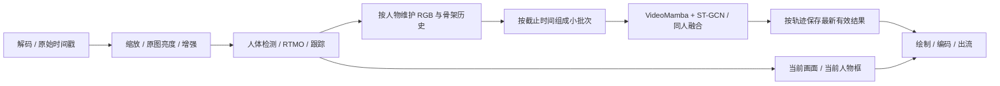

# 逐人动作识别优化方案（2026-10-23）

状态：设计方案，尚未实施或测得优化收益。适用于单卡和多卡，目标是处理≥15个新视频帧/秒、识别结果时延≤1秒。
依据：[性能报告](analysis-report.md)、[原逐人实现](../person-action-20261023/scripts/demo.py)、现役server.py的单卡争用与多卡分工记录。

## 1. 优先方向及边界

先改善逐人VideoMamba的数据处理、批处理和任务调度，再调整采样频率；若计算仍不足，再训练轻量模型。
维持最新ROI候选、每人自己的RGB与骨架、α=0.7、动作阈值0.75、原图照度门75，不引入物体先验。
YOLO继续用于人体框。当前RGB已有FP16 autocast，Retinexformer也已是FP16，不能把“开启FP16”当作新收益。

- 原视频单人/双人/三候选框实测10.11/9.34/8.33fps。
- 拥挤回传片段约4fps，逐人动作占总耗时约67%–68%；每次多人调用最长3.36秒。
- 双人单次动作调用中位约0.50秒，单人约0.27秒；现有batch=2尚未表现出显著的人均成本下降。必须实际测试更大批次，不能按批量大小推算加速倍数。
- 原视频增强、检测、姿态分别约26、16、10–11ms/帧。仅这些调用在当前串行路径就占约52ms，距15fps的66.7ms/帧预算已很近。
- 以上是含预处理和同步的调用墙钟时间，不是纯GPU核函数时间。先细分CPU/GPU开销，才能判断多卡与算子优化的收益。

## 2. 单卡、多卡共用的流程

算法和人物历史管理统一，设备分配由调度配置决定。CPU负责解码、跟踪管理、调度与输出；每张GPU有一个统一计算任务提交者。
单卡时GPU任务受控交错执行；多卡时前端和动作任务可在不同设备同时执行。多个Python线程向同一GPU抢算力不作为默认方案，仓库已有反例。
拆线程只能改善任务重叠和输出阻塞，不能让GPU凭空增加算力，也不能保证动作结果不过期。

## 3. 第一阶段：保持模型与时间窗，减少重复工作

| 项目 | 具体改动 | 预期作用与验证 |
|---|---|---|
| 细分动作耗时 | 分别记录窗口拼接、归一化、H2D、布局转换、RGB前向、骨架分类、融合；CPU墙钟结合CUDA Event/短段profiler | 明确约0.27秒/人花在哪里；正式测速关闭高开销profiler |
| uint8上传、GPU归一化 | 不在CPU将整段人物窗口展开为float32再上传；上传uint8后在GPU按原mean/std归一化，先保留float32归一化语义及现有autocast | 每人32×224×400×3的数据从约34.4MB降为8.6MB上传；这是数据量降4倍，不是推理速度提升4倍 |
| 固定缓冲区与历史复用 | 预分配窗口/批次缓冲区；保留逐帧ROI，按原32个时间点索引。测试pinned memory与异步复制，明确缓冲区复用同步 | 避免反复np.stack、分配和窗口重叠部分的上传/归一化。是否保留GPU环形缓存由实际显存预算决定 |
| 动态小批次 | 对真实窗口测batch=1/2/4/8/16的窗口吞吐、单批时延、显存；按最早截止时间组批，等批上限先试10–20ms，近截止直接发出 | 兼顾多人吞吐和结果时效，不为了凑满大批而延迟单人输出；16是测试档位，不是默认值 |
| 每批完成即发布 | 当前predict把所有人物都算完才返回；改成小批次独立发布，再持续处理剩余人物 | 前面已完成的人不再等最后一个人；不等同于最后一个人的计算也加速 |
| 精简运行路径 | crop哈希、示例JPEG、完整概率数组等转到诊断模式；正常运行保留事件和必要统计 | 去掉非业务成本；不能把这项当作解决主要模型瓶颈的承诺 |
| 输出独立执行 | 将显示放大、绘制、编码与模型调用解耦；验证后可用NVENC降低CPU编码压力 | 保持显示尺寸、标签和片段规则；编码卸载需在现有镜像检测编解码能力，不能只看ffmpeg列出编码器 |

注意：CPU OpenCV裁剪/letterbox第一版先保留，以便对齐训练输入；GPU裁剪插值需要单独验证像素和准确率。
跨窗口可复用输入帧、预处理和存储，不能直接复用双向VideoMamba的隐藏状态或缓存旧分类冒充新窗口结果。
GPU归一化、batch形状改变可能带来数值差异，需比较概率偏差与0.75阈值附近的标签变化。

## 4. 实时调度：控制积压，同时保证每个人被更新

- 以源视频PTS/可靠采集时刻定义窗口，禁止用处理完成时间代替；每人保留约1秒观测历史，仍取32个采样位置，目标每0.5秒更新一次动作。
- 输入、前端与动作任务队列都有容量和年龄上限。离线验证可排空全部帧；在线超载时合并同一轨迹尚未开始的旧窗口，只保留最新待算窗口，正在执行的任务不强行取消。
- 合并旧任务会降低动作覆盖率，必须统计每个人的实际更新频率、最大更新间隔、未处理窗口比例。不能只报告画面流畅而遗漏人物结果。
- 对每个轨迹按最早截止时间调度，保证公平；过载时显式记录，不能只选前K个人或长期跳过置信度低的人来声称达标。
- 用`会话/轨迹代次/track_id/窗口结束时间`绑定RGB、骨架和结果；到达较晚的旧结果不能覆盖较新结果，消失/重建的轨迹不能继承旧动作。
- 更新显示时检查源窗口年龄。超过1秒且没有新结果时显示待更新状态；不要将计算未完成伪装成“其他”。已完成且非other概率不足0.75时仍按用户要求显示“其他”。
- 每个动作结果携带来源窗口、人物框和分支状态；绘制与片段触发使用同一结果快照。保存片段围绕动作来源时间截取，不能围绕异步计算完成时间截取。

目标是把工作队列保持短，而不是通过丢旧任务掩盖算力不足。同步报告“画面fps”和“逐人识别服务率”。
每人2次/秒意味着N个人需要约2N个人物窗口/秒：2/4/8/16人分别需要4/8/16/32窗口/秒。
选设备数量和批次时必须达到这一需求，并留有实测余量，而不只是让输出线程刷新15次/秒。

## 5. 按卡数分配

| 配置 | 建议分工 | 必须验证的瓶颈 |
|---|---|---|
| 单卡 | 一个GPU计算调度器管理增强、YOLO、RTMO和动作小批次；CPU输入/输出并行；充分复用ROI缓存 | 同卡增强与动作总工作量；大批动作不得长时间挡住新帧，增加线程不等于增加容量 |
| 双卡 | GPU0：增强＋YOLO＋RTMO；GPU1：逐人VideoMamba＋ST-GCN；跟踪/结果归并由统一管理器负责 | GPU0的新帧处理能力和GPU1的人物窗口/秒都要达标；拥挤场景可能仍是GPU1不足 |
| 三卡 | GPU0：前端；GPU1/2：动作模型副本，按人物窗口分配 | 优先扩展目前最重的动作分支；不要照搬旧整帧服务“其余卡全做增强”的分工 |
| 更多卡 | 根据实际前端耗时、动作吞吐及跨卡传输选择扩展前端或动作副本 | 扩前端要保持帧顺序和统一跟踪；扩动作要避免人物饥饿和结果错配 |

动作模型按GPU复制，按轨迹优先分配到固定worker以复用缓存，必要时在窗口边界迁移；迁移后校验轨迹代次和历史，不混用旧缓存。
传输紧凑人物ROI与17点骨架，优先逐帧增量上传并在动作卡维护窗口，避免每次把完整32帧float32窗口或全景大图跨卡重传。
GPU P2P与共享内存路径须实测；不可假设平台容器/HAMI支持所有设备间访问。
batch及缓存上限按平台实际分配显存/算力预算决定，不能仅依据宿主机“24GB显卡”。

没有承诺“单卡必达15fps”或“多两张卡就线性加速”。每种人数和卡数必须重新实测。

## 6. 第二阶段：允许改变采样或部署算子时再评估

1. **人体检测降频＋逐帧跟踪**：先试每2帧检测一次，中间帧用运动预测/光流更新人物框，进入/遮挡/跟踪异常时触发补检。当前tracker依赖检测输入，必须实现跳检帧的更新与置信度管理，不能只跳过函数调用。
2. **姿态降频**：在框追踪稳定后单独测试。保留每个骨架的实际时间戳、可见性和插值标志，不把重复/插值骨架当成新观测计入质量门。它会改变骨架时序输入，虽然ST-GCN权重没变，也必须重新验证动作精度。
3. **输入采样频率**：若从25/30fps采样到15/20fps，仍按真实时间维护约1秒窗口，再取32个位置。重复采样不等于32个独立观测；当前训练数据多为原帧率，需验证快动作、轨迹丢失和窗口有效率。
4. **部署后端**：优先试YOLO/RTMO的ONNXRuntime I/O Binding、固定shape及可用的TensorRT引擎。VideoMamba含selective-scan等自定义CUDA算子，torch.compile/CUDA Graph/TensorRT需要逐项兼容验证，不能承诺直接整体转换。
5. **轻量逐人RGB学生模型**：若前面优化后单卡仍不能承载所需人数，评估32→16帧、400×224→224×224或更小模型，用现有逐人数据和模型做蒸馏/微调。逐项消融，先验证后选择，不能把现模型直接改尺寸或帧数就上线。

暂不把“亮场直接跳过增强”“动作安静就长期不跑RGB”“无有效姿态就不识别人”作为默认优化：这些都可能改变输入域或漏掉喝水等细微动作。
照度门75控制骨架分支，不能未经验证拿它当作增强的开关。

## 7. 实施顺序与验收

1. 补细粒度profile与逐人服务率统计；保留当前6段输入和结果作为复现基线。
2. 实现uint8上传/GPU归一化、固定缓冲、小批次选择和逐批发布；逐项记录独立收益，先完成单卡回归。
3. 实现统一调度及双卡/三卡映射；复用现有服务的生命周期和出流能力，但新增逐人事件、快照、轨迹和片段规则。
4. 只有性能仍不够时再逐项试检测降频、推理后端、轻量模型；避免一次改动多项后无法定位精度回退。

验收矩阵：1/2/4/8人及现有拥挤场景，原视频完整增强链与回传片段分别记录；单卡、双卡、三卡分别实测，不能以一个场景代替全部配置。
使用可获得的长源视频持续运行至少10分钟；缺乏长源时明确标记循环边界和跟踪重置，不当作真实连续多人监控的证明。

- ≥15个不同源帧/秒；同时报告输出帧新鲜度、重复帧、丢帧、窗口无效和队列积压。
- 每个持续可见且具备有效观测窗的人目标2次新识别/秒，统计每人更新间隔、覆盖率、尾部与最差者，不能只给全体平均。
- 最新窗口帧→决策的P50/P95/P99/最大值、>1秒数量；若1秒是硬上限，不能用P95达标代替最大值约束。还需检查显示结果的源窗口年龄。
- 新轨迹约1秒观测窗预填单独统计；“动作开始→识别”还包含观测和触发节奏，需有动作起点标注才能验收，不与计算时延混同。
- 不改变采样的工程优化，核对逐人输入/时间点/分支与基线，解释所有概率和标签差异。改变采样、后端或模型时重测当前逐人204窗与源视频时序评估，关注喝水召回、other误报、快速动作和ID串人。
- 204窗已经被查看过，后续多次用它选择参数会形成验证泄漏；将其作为回归集，最终新模型效果再用新会话或新增标注视频确认。
- 在平台实际镜像及GPU配额下补测实时推拉流、片段保存和正常收尾，再生成新交付包；不能把本机3090的结论直接当作平台验收。

期望交付：同一份逐人代码、按卡数选择的调度配置、每种人数的容量实测表、精度回归结果和平台验收记录。
