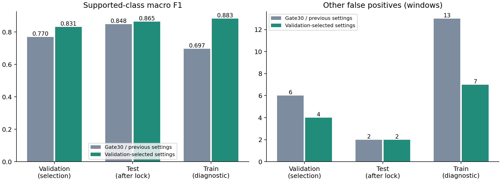
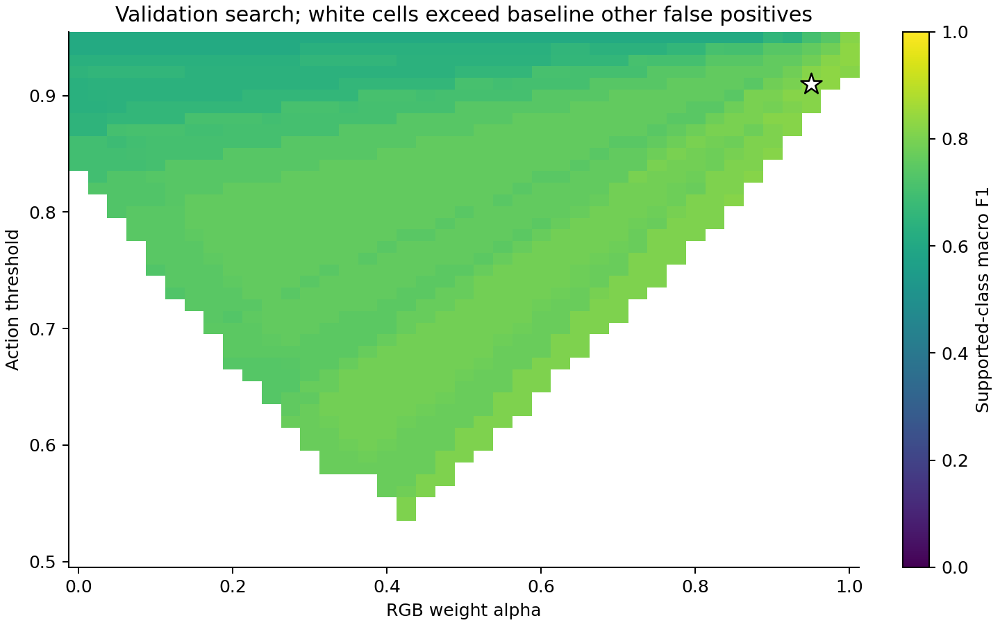

# 逐人方案：现场模型适配与参数选择

默认原图亮度门为 **30**；验证集选定 RGB 权重 **0.95**、动作阈值 **0.91**、无合格骨架策略 **soft**，骨架模型选择 **old**。

比较问题是：在最新清理展品人体模型、暗场姿态和逐人 RGB 固定后，骨架适配及参数选择能否改善动作识别，同时不增加验证集 other 误报。基线为同样门30、旧现场ST-GCN、α0.7、阈值0.75、soft策略。

| 划分 | 有标签窗 | 宏F1 原→选定 | other误报 原→选定 | 正动作正确 原→选定 |
|---|---:|---:|---:|---:|
| val | 198 | 0.7697 → 0.8309 | 6 → 4 / 162 | 25 → 27 / 36 |
| test | 214 | 0.8477 → 0.8646 | 2 → 2 / 163 | 33 → 37 / 51 |
| train | 3297 | 0.6968 → 0.8825 | 13 → 7 / 2829 | 427 → 452 / 468 |

535段去重来源共49160帧，按原录制家族／线上会话固定417训练、60验证、58测试；逐人窗口随检测结果变化，不能与旧固定窗成绩直接混比。人物标签按原逐人时间标注做空间迁移，迁移不可靠者保留未知，不当其他；3条先前无预测预览审核标签仅按完全一致的裁剪哈希和帧索引复用。覆盖细节见 results.json，未检出的人不计为正确。

训练只更新ST-GCN；仅一个随机种子24。候选训练20轮，验证选轮后搜索41种RGB权重×46种阈值×2种缺骨架策略×2套骨架模型。约束为验证集other误报不高于基线，再最大化已覆盖类别宏F1。完整网格见 parameter-grid.json；selection-lock.json写入后才统计测试集。大量网格选择可能对小验证集过拟合，所选参数是本批协议下的选择，不是普适最优。

图1应按验证、测试和训练三个口径分别阅读。柱形是单次固定模型的人物窗统计，没有种子误差条；训练回放不能支持泛化结论。

图2白色空格表示other误报超过预设上限，星号是锁定选择。它展示召回与误报的取舍，不是测试集调参图。各亮度段的真实正／负样本数在 brightness-results.csv；没有正样本的格子无法证明动作召回。

增强仍为公开NTIRE预训练Retinexformer；此前现场增强微调损害识别，未采用。人体YOLO26m、姿态RTMO-s、逐人VideoMamba及骨架动作模型均具有现场训练来源。暗场姿态标签是辅助标注，经质量筛选，不是独立人工精标。

历史初始化已见过部分旧视频，测试集此前也被查看。当前指标只覆盖有真值且能形成时序窗的人，不能代表全摄像头端到端召回，不能宣称9类都充分验证。线上增强片段原图L未知，不可归入亮场档位。实时丢帧与模型更新会改变窗口，需另看正式包真实流验收。
