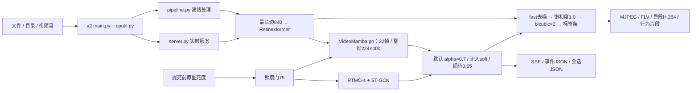

# dark-demo-v2 原包审查与镜像验收报告

审查日期：2026-10-14。仓库基线：`311fede`。依据：项目 `AGENTS.md`、交付目录 `CLAUDE.md`、实际代码、清单、权重以及容器运行结果。审查对象是本次提交的原始归档，诊断脚本与参数对照没有写回提交包。

**结论：原包可以在给定镜像中启动、加载现役模型、输出视频并识别已知样例，但当前存在运行稳定性与结果完整性问题，双卡降级配置的实测性能也未守住“≥15 fps、识别时延≤1秒”。建议修复并重新验收后提交。清单申请的三卡配置尚缺真实三卡性能验收。**

## 1. 验证对象与环境

| 项目         | 本次实际验证对象                                                                     |
| ------------ | ------------------------------------------------------------------------------------ |
| 算子包       | `platform/dark-demo-v2.tar.gz`，190,529,109 字节                                   |
| 包 MD5       | `75c14464a47e28c45b547563b7c8a846`，与 AGENTS 的最新包记录吻合                     |
| 包 SHA256    | `74b30d21ea0367a34df60f2ebb807337baa4cbb219c35fe288f187c68adc9e91`                 |
| 镜像来源     | 实际执行`docker load -i platform/darkpipe-operator-0.3.0.tar.gz`                   |
| 加载的标签   | `darkpipe-operator:0.3.0`                                                          |
| 镜像 ID      | `sha256:d359716620d7eb757cd7c36733e25642469450f1c801e0367fc99248f0a2f212`          |
| 容器解释器   | `/opt/conda/envs/darkpipe/bin/python`，Python 3.10                                 |
| 实时性能资源 | 2 × 空闲 RTX 3090 24GiB，CPU quota=8，内存上限=12GiB                                |
| 原清单资源   | `gpu.count=3`、`gpu_ids=0,1,2`、CPU limit=8、memory limit=12Gi                   |
| 实时输入     | 本机 HTTP multipart MJPEG，1080p、JPEG quality=95，按25fps循环发送真实`喝水16.mp4` |
| 现场连接边界 | 本次未连接平台实际摄像头或 NameNode；交付复制使用本地第二目录，未向实际平台写入      |

主机 GPU 2–5 正在被其他训练任务使用，本次只使用 GPU 0、1。三次实时性能测试逐次运行；随后四套件回放使用 GPU 0、离线功能验证使用 GPU 1，两项功能验证可并行，其耗时不作为实时性能验收值。

包中原始44个文件完成路径安全与逐文件哈希核对，没有路径穿越或链接问题。代码、清单、字体及7份权重均与仓库交付目录一致，只有 `README.md` 内容有差异。完整记录见 [package-integrity.json](submission-audit-20261014/evidence/package-integrity.json)。

归档包含 `dark-demo-v2/` 外层目录；本次将解包后的该内层目录只读挂载到 `/opt/darkpipe/op`，并以它为容器工作目录运行清单的 `main.py`。这里验收的是实际代码在指定镜像中的执行，尚未通过真实平台的解包、工作目录和新清单导入流程。

## 2. 仓库结构与实际执行链

| 路径                                                | 职责与本次判断                                                                |
| --------------------------------------------------- | ----------------------------------------------------------------------------- |
| 根`main.py` / `darkpipe/cli.py`                 | 通用研究入口，支持多种增强、超分和识别后端                                    |
| 根`darkpipe/`                                     | 通用流水线、旧部署逻辑、媒体读写、出流、切片及模型适配                        |
| `compare/`                                        | 缓存、训练、模型比较、现场回放、骨架融合和照度评估；其中部分工具仍有口径问题  |
| `scripts/`                                        | 权重获取、参考输出、模型实现一致性检查                                        |
| `platform/op_*`                                   | 较早的平台算子入口；由旧通用打包脚本处理                                      |
| `platform/dark-demo-v2/`                          | **本次交付的实际运行源**，包含自己的 `darkpipe/` 副本与 `oputil.py` |
| `platform/Dockerfile`                             | CUDA/PyTorch/Mamba、FFmpeg、骨架等运行依赖；默认优先使用算子包的现役权重      |
| `tests/`                                          | 主要针对根目录通用代码和旧算子，不能直接视为 v2 新逻辑的覆盖证明              |
| `real-actiondata-*` / `online-negative-sample/` | 现场视频和平台回传片段                                                        |
| 仓库外`../compare/behavior/cache/`                | 实际使用的部分历史与 pn 训练缓存；检查数据来源时也核对了这里                  |

实时双卡时，一卡增强、另一卡识别；三卡时两卡轮询增强、一卡识别。离线启用默认切片时会主动退到单卡。识别读取增强后、去噪与超分前的画面；低于照度门的窗口采用纯 RGB，门上采用骨架融合。`max_prior` 保留为可选模式，本次默认验收遵循 AGENTS 的 `alpha` 裁决。

实际加载的是 `videomamba_t_behavior_32f_realactall_full_pn.pth`，MD5 `513cafeb601f8e0eb80ed22433838eca`，元数据 `epoch=12`、`preprocess=fullfov224x400`，整帧视野核对通过。RTMO 使用 CUDA EP，识别卡为 `cuda:1` 时其 `device_id=1`，没有意外退到 CPU 或旧裁剪链。RGB 热身后探针中位约72.6ms，姿态探针约11.0ms/帧。依赖版本和各权重指纹见 [image-probe.json](submission-audit-20261014/evidence/image-probe.json)。实际镜像的 `/opt/darkpipe/ckpts` 仍包含旧权重，具体清单见 [image-bundled-weights.json](submission-audit-20261014/evidence/image-bundled-weights.json)；这是对“镜像不含权重”说明的纠正，默认包内 `ckpts` 解析本次已核对。

## 3. 需要修复的问题

P1 表示阻止当前包直接验收的问题；P2 表示特定参数或辅助流程中的正确性问题。以下源码位置均指 `platform/dark-demo-v2/`，与原归档代码一致。

### P1-1：处理线程死亡后，服务仍可能返回健康

位置：[server.py:630](/ssd1/wfs/project/lowlight/DarkScenePipeline/platform/dark-demo-v2/darkpipe/server.py:630)、[健康判断:1358](/ssd1/wfs/project/lowlight/DarkScenePipeline/platform/dark-demo-v2/darkpipe/server.py:1358)。模型收尾和服务主流程分别见1197与1578行。

工作线程捕获异常后只设置局部 `done`，主增强循环失败也只收尾模型。该状态没有传播给 `ServerState`、健康接口或 Uvicorn 主流程。`/health` 的主要健康条件仍是 `capture_alive`；采集线程继续工作时，识别、增强或输出已经停止，HTTP仍返回200和 `status=ok`，会话仍保持 `running`。加载模型发生在处理线程，启动失败也可能留下同类状态。

复现：向增强阶段注入 `RuntimeError('injected enhancement failure')`。处理线程已死亡、`stop_flag=false`，调用实际注册的健康路由处理函数仍得到200/ok的JSONResponse。证据：[failure-probe.json](submission-audit-20261014/evidence/failure-probe.json)、[复现脚本](submission-audit-20261014/scripts/failure_probe.py)。

修复方向：显式记录初始化、处理存活、最近产帧时间及致命错误；处理失败应通知服务退出并让主入口写失败会话、非零退出。健康判断同时检查处理状态，防止冻结画面继续被报为健康。

### P1-2：持续 SSE / MJPEG 连接阻止到期退出

位置：[无限SSE循环:1565](/ssd1/wfs/project/lowlight/DarkScenePipeline/platform/dark-demo-v2/darkpipe/server.py:1565)、[到期处理:1595](/ssd1/wfs/project/lowlight/DarkScenePipeline/platform/dark-demo-v2/darkpipe/server.py:1595)。MJPEG生成器与lifespan停止设置分别见1434与1343行。

`run_seconds` 定时器只设置 `server.should_exit`。SSE 和 MJPEG 的生成器使用无限循环，没有停止条件；Uvicorn 优雅退出等待这些请求结束，lifespan 的 `st.stop.set()` 又在后面的退出阶段，因此开放连接可使退出流程一直等待。SSE 在没有事件时仍定时发送 ping。

原包实测 `run_seconds=75`，保持 SSE 订阅，到期打印“开始收尾退出”后仍持续处理。驱动在195秒上限后执行 `docker stop -t20`，最终退出137，会话仍为 `running`。提前断开 SSE 的两次对照能正常退出0并写 `stopped`。证据：[默认服务日志](submission-audit-20261014/evidence/live-quality/container.log)、[默认会话与指标](submission-audit-20261014/evidence/live-quality/summary.json)。

修复方向：统一到期、信号和失败退出的停止通知，让所有流生成器结束并唤醒 SSE 队列等待；配置有界的优雅退出超时，确保处理、录制和会话收尾能够执行。验收要覆盖“客户端持续连接到结束”。

### P1-3：双卡、清单 CPU / 内存限制下，默认性能未达标

默认实时测试保留清单参数：840、Retinexformer、pn、骨架alpha0.7、门75、阈值0.65、画面fast去噪、片段quality去噪、MJPEG与FLV。只覆盖输入、输出目录、测试端口、运行75秒和空 `extra_hosts`；`gpu_ids=0,1,2` 按包逻辑降到两张可见卡。

按20–75秒统计，默认处理帧率中位9.80fps，仅9/53个健康快照达到15fps；识别事件送达延迟中位1261ms、p95约3100ms、最大3443ms。处理帧延迟快照最大2028ms。默认日志还出现识别队列积压及丢帧。

观测到约200个进程/线程、CPU接近8核上限及显著 cgroup 限流。RTMO 经 rtmlib 创建 ORT session 时没有设置线程池选项；PyTorch/OpenCV等也未统一约束。片段quality在独立线程中执行仍争用同一 CPU 与内存资源，不能假设它对实时性能免费。

关闭片段去噪并加线程环境变量的对照提高到14.24fps中位，事件延迟p95仍约1578ms。保留quality、额外约束ORT及PyTorch/OpenCV的诊断启动器减少限流，但中位帧率仍11.92fps，事件延迟p95约1608ms，片段有弃段/丢帧。**这些对照用于定位瓶颈，没有证明调整后已达标，也没有改变原包。**

修复方向：按容器资源配置线程池，核对开窗复制、姿态调用、增强和片段去噪成本；以完整默认功能和真实清单三卡配置复验。若提供双卡降级能力，也应给出能满足指标的独立配置。不能用FLV头部的15fps或历史无相同资源约束的数字代替处理帧率。

### P1-4：离线慢写时，30秒超时可能造成未完成片段被当作完成

位置：[clips.py:398](/ssd1/wfs/project/lowlight/DarkScenePipeline/platform/dark-demo-v2/darkpipe/clips.py:398)、[main.py:407](/ssd1/wfs/project/lowlight/DarkScenePipeline/platform/dark-demo-v2/main.py:407)。写线程的daemon配置见clips.py第232行。

离线模式 `realtime=False` 使用无上限队列，说明承诺慢写只延长耗时、不会丢片段；但 `close()` 仍只 `join(timeout=30)`，返回后没有检查写线程是否还活着或传播失败。主流程随后扫描已完成的片段并交付，最后删除工作目录；写线程是 daemon。结果可能是整段视频已交付、会话标为finished，而动作片段仍在队列/暂存目录中，随后丢失。

复现：对原包 `ClipRecorder(realtime=False)` 模拟慢写，50帧入队。`close()` 30.000秒后返回，写线程仍活着、队列31条、已保存0段、没有元数据；解除阻塞后才保存1段。证据：[clip-contract.json](submission-audit-20261014/evidence/clip-contract.json)。这是可控慢写复现，本次四段正常短视频的片段均已完整交付。

修复方向：离线需要等待队列真正排空并传播写入失败，或在有界超时时明确失败；完成状态和工作目录清理须以全部目标产出结束为前提。实时退出若有未完成片段，也要报告明确的未完成数。

### P2-1：片段去噪只处理开头，后续帧漏处理

位置：[开头去噪:673](/ssd1/wfs/project/lowlight/DarkScenePipeline/platform/dark-demo-v2/darkpipe/clips.py:673)、[后续帧漏处理:695](/ssd1/wfs/project/lowlight/DarkScenePipeline/platform/dark-demo-v2/darkpipe/clips.py:695)。

`open_now()` 对预卷及最初20个后续帧调用 `_clean()`，编码器打开以后 `frame` 分支直接 `emit(item[1], item[2])`，未再调用去噪。这与 `clip_denoise` 对整个保存片段生效的参数说明不符，会使片段前后采用不同去噪策略。

复现：50个输入帧、quality模式、无丢帧，实际 `_clean()` 仅调用21次；已正常写出视频。证据同 [clip-contract.json](submission-audit-20261014/evidence/clip-contract.json)。修复应在重采样复制前对每个新帧处理一次，并重新测量整个片段去噪后的资源成本。

### P2-2：直接命令行默认阈值与平台清单不同

位置：[main.py:87](/ssd1/wfs/project/lowlight/DarkScenePipeline/platform/dark-demo-v2/main.py:87)；清单 `inputs.reco_min_conf`。

CLI默认0.5，平台清单与部署评估使用0.65。省略该参数直接运行，会采用更宽松的触发条件，识别/存片结果与平台不同。参数覆盖检查发现这是一个实际默认值差异；新增参数都已进入清单和args。args顺序与CLI声明顺序不同，但具名参数运行正常，因此没有把顺序差异列为运行故障。证据：[static.json](submission-audit-20261014/evidence/static.json)。

同一套全精度窗口概率改按0.5拒绝阈值回放后，B触发从5/365变为6/365，P从2/460变为25/460；这处默认差异已有明显的结果影响。修复方向：统一到0.65，并对清单默认值、choices和入口参数做 v2 专用一致性验证。

### P2-3：离线多卡可达路径依赖未打包的 CLI

位置：[main.py:293](/ssd1/wfs/project/lowlight/DarkScenePipeline/platform/dark-demo-v2/main.py:293)、[shard.py:103](/ssd1/wfs/project/lowlight/DarkScenePipeline/platform/dark-demo-v2/darkpipe/shard.py:103)。

当用户显式清空 `clip_dir`、输入足够长且有两张卡，主入口进入分片，子进程启动 `python -m darkpipe.cli`；原包没有该模块。300帧输入分成0–149及150–299帧，两个子进程均报 `No module named darkpipe.cli`，主进程退出1并写failed。证据：[shard-probe.json](submission-audit-20261014/evidence/shard-probe.json)。154帧的短输入会退到单卡，不能用短样例证明多卡分片可用。

原清单默认非空 `clip_dir` 会限制离线单卡，因此正常默认批处理不触发这一故障。包内CLAUDE已经承认缺CLI，但README仍描述清空切片目录后可用离线多卡。

修复方向：明确禁止此组合，或提供完整的独立分片入口并传播新版融合/阈值/画面参数。直接复制旧根CLI仍可能丢失 v2 参数语义。

### P2-4：可选物体检测未使用指定 GPU，异常保护也不完整

位置：[object_prior.py:106](/ssd1/wfs/project/lowlight/DarkScenePipeline/platform/dark-demo-v2/darkpipe/stages/object_prior.py:106)、[未保护的探针:114](/ssd1/wfs/project/lowlight/DarkScenePipeline/platform/dark-demo-v2/darkpipe/stages/object_prior.py:114)。

构造 `YoloOnnxDetector(..., 'cuda:1')` 后，session只传CUDA provider字符串，没有 `device_id`；镜像实测实际 `device_id=0`。选择max_prior时，它会与增强卡竞争，破坏识别卡独占的资源安排。默认alpha不加载该检测器，因此默认识别验收未受此问题影响。

此外，session创建有try/except，后续热身与计时探针在保护范围外；运行期调用也不保护。此处“load永不致命/缺检测器自动放行”的注释不能覆盖推理异常。修复应传入正确设备ID，并让初始化探针错误真正遵循降级契约。

### P2-5：现有评估工具与生产 soft 策略不完全一致

位置：[prior_eval.py:227](/ssd1/wfs/project/lowlight/DarkScenePipeline/compare/behavior/skeleton/prior_eval.py:227)、[舍入写盘:223](/ssd1/wfs/project/lowlight/DarkScenePipeline/compare/behavior/skeleton/prior_eval.py:223)、[lum_sweep.py:55](/ssd1/wfs/project/lowlight/DarkScenePipeline/compare/behavior/skeleton/lum_sweep.py:55)。

`prior_eval.alpha_fuse()` 在无人窗口直接输出other one-hot；生产默认soft为 `alpha·RGB+(1-alpha)·other`。例如RGB某行为0.99、alpha0.7、无合格人时，生产该行为可达到0.693而触发，评估的硬策略会压成other。低人出现率窗口的误报统计因此不能自动等同于服务。

该工具对RGB及alpha向量写盘时仍round4位，照度扫描从这些舍入值回放；在阈值边界无法保证“逐位精确”。本次四套件使用原包 `BehaviorRecognizer.push()`、生产soft/照度门/拒绝逻辑，保留全精度概率，绕过这些工具差异。

### P2-6：旧打包流程与文档不足以复现当前交付

位置：[make_operator_zip.sh:65](/ssd1/wfs/project/lowlight/DarkScenePipeline/platform/make_operator_zip.sh:65)、[源复制:92](/ssd1/wfs/project/lowlight/DarkScenePipeline/platform/make_operator_zip.sh:92)、[build_image.sh](/ssd1/wfs/project/lowlight/DarkScenePipeline/platform/build_image.sh)。

旧打包脚本只遍历 `op_*`，从根 `darkpipe/` 复制旧流水线，打旧裁剪链行为权重，不包含当前pn/骨架交付栈；`dark-demo-v2` 也缺少该脚本要求的 `zip_name`。它不能作为当前tar的重打包入口。`build_image.sh` 默认标签仍为0.2.0，而本次验收镜像是0.3.0。

清单description及多处旧说明仍说2卡、旧双卡轮询/旧帧率或“单卡720达15”；实际默认是3卡、最后一卡独占识别且包含骨架。权重元数据 `lwf=0.2`，AGENTS的pn训练叙述写2.0，也需要核对训练记录。另，离线片段sidecar的 `video` 字段保留 `/tmp/darkserve_...` 工作路径，交付后该目录被删除；浏览交付文件时应使用会话中的最终地址，建议将sidecar改为相对文件名。

修复方向：为v2建立能复现当前源、权重与清单的明确打包入口，用哈希和镜像实际运行作为交付门槛，并同步对应文档及训练来源记录。

## 4. 实时验收结果及计时口径

健康接口每秒采样；表中仅使用20–75秒窗口且处理帧率>0的记录。处理延迟是健康接口的最后一帧快照，因此这些分位数是采样分位数，不代表每帧完整分布。识别延迟从事件对应最后一帧的捕获时刻到本机SSE客户端收到事件计算，包含排队、开窗、推理和事件发送，不包括积累1秒识别窗的等待；只统计事件时间20–75秒，排除默认退出阻塞后的额外运行。

| 运行                               | 健康快照数 |     处理fps中位 | 达15fps快照 | 帧延迟p95 / 最大 |           SSE识别延迟中位 / p95 / 最大 | 退出                           |
| ---------------------------------- | ---------: | --------------: | ----------: | ---------------: | -------------------------------------: | ------------------------------ |
| 原包清单默认，片段quality          |         53 |  **9.80** |        9/53 |     936 / 2028ms | **1261 / 3100 / 3443ms**（12条） | 持续SSE下无法到期退出，强停137 |
| 片段off + 线程环境限制             |         45 | **14.24** |       15/45 |     714 / 3549ms |   955 /**1578 / 1652ms**（13条） | SSE提前断开，退出0/stopped     |
| quality + 线程限制 + ORT诊断启动器 |         55 | **11.92** |       17/55 |     333 / 1157ms |   974 /**1608 / 1719ms**（12条） | SSE提前断开，退出0/stopped     |

第二轮保存18个片段、无弃段/录制丢帧；第三轮保存6个片段、弃段2、录制丢帧21。这个结果也说明quality录制目前仍会影响持续产出。三次是不同参数对照，不能合并为同一性能分布，75秒回放也不是整夜耐久测试。

FLV样本能播放，编码H.264、1680×1020、15fps。该15fps来自出流的固定节拍，可能重复最近帧；不能据此判断处理流水线达到15fps。尺寸来自840×472处理画面、bicubic×2得到1680×944，再追加76像素标签条。

详细指标：[live-comparison.json](submission-audit-20261014/evidence/live-comparison.json)。每次完整参数数组、健康采样、事件记录与服务日志保存在同名证据目录。

## 5. 四套件全量识别回放

全量1020窗在指定镜像中完成，退出0，耗时1488.9秒（约24.8分钟），骨架分支始终启用。平台清单默认阈值0.65结果如下：

| 套件          | 本次实测                                   | 原图低于75的窗数 | 与AGENTS最新记录核对         |
| ------------- | ------------------------------------------ | ---------------: | ---------------------------- |
| A：177窗/33段 | **177/177，top1=1.0000，mF1=1.0000** |              105 | 复现                         |
| B：365窗/64段 | **5/365触发（1.37%）**               |              204 | 复现；均为全片窗的chase      |
| C：18窗/4段   | **18/18命中**                        |                0 | 复现                         |
| P：460窗/96段 | **2/460触发（0.43%）**               |                0 | 文档为1/460，本镜像本次多1窗 |

B的5个触发窗为 `other74/other76/other78/other79/other87@whole`。P的2个窗都来自 `20261012_101308_drinking_water_0104`：`t0.0` 的喝水置信度0.8607484，`t0.5` 为0.6509651，后者刚超过0.65。额外在增强batch1（实时路径）、8（全量回放）、32（默认离线路径）核对该片，这两个窗都触发，边界窗分别约0.6523、0.6513、0.6510；因此不能在本次验收中直接沿用文档1/460。见 [批量敏感性记录](submission-audit-20261014/evidence/batch-sensitivity.json)。

P全部按套件other标注计触发；AGENTS对0104已记为真实喝水/标注歧义素材，[该片四帧对照](submission-audit-20261014/visual/P0104-source-strip.jpg)也保留了原场景，需人工复核真值，不能把这两个触发窗直接解释为两个新的明确误报事件。同片多个窗也不是独立样本。

完整逐窗全精度证据：[native-windows.jsonl](submission-audit-20261014/evidence/native-windows.jsonl)、[native-summary.json](submission-audit-20261014/evidence/native-summary.json)、[回放日志](submission-audit-20261014/evidence/native-suites.log)。

方法：按缓存起始帧对齐A，B/C/P包含全片窗口和1秒、0.5秒步进窗口；每窗均匀取32帧。用原归档Retinexformer（batch8）和 `BehaviorRecognizer.push()`，整帧224×400、alpha0.7、无人soft、原图照度门75、平台阈值0.65，实际启用RTMO+ST-GCN。逐窗重置识别环形缓存；增强只跳过没有被任何窗口使用的帧，未替换模型或融合公式。增强batch形状的fp16数值可有细小差异，本次对新出现的边界窗已覆盖实际实时/离线batch复核；不宣称该回放逐像素等同于一段连续实时流。回放GPU耗时不作为实时服务时延。

**数据证明范围：** A只有5种标签：追逐30、喝水39、捡东西17、挥手22、other69个窗口。C只有4种具名动作。pn训练缓存中可找到A全部33段、B全部64段、C全部4段，以及P全部96段；P的286个训练缓存窗也确实存在。四套件是换装回归验收，当前没有一套是pn模型的独立新视频测试。AGENTS中“只有P全新”适用于加训前模型，不能延续到本次pn模型。投掷、跌倒、打架、交谈、握手等其余5种动作尚没有本次现场独立验收证据。来源核对见 [data-provenance.json](submission-audit-20261014/evidence/data-provenance.json)。

## 6. 离线输出、媒体完整性和画面效果

原包在指定镜像中实际运行了4段正样本的目录批处理和一段暗光 `追逐19.mp4` 的单文件处理，均退出0、会话finished。默认离线启用切片，所以只用一张卡；每个正样本输出整段H.264、动作片段、sidecar和事件JSON，第二本地交付目录内容逐文件哈希一致。

对3次实时与这5段离线输入已经完成的54个视频/FLV进行FFprobe检查和FFmpeg完整解码，未发现解码错误；片段 `frames_written` 与实际解码帧数一致，元数据时长误差在一帧容差内。5个整段离线输出的帧数、帧率与输入一致；这些检查针对已完成落盘的文件，不能替代对弃段和关机前未完成队列的检查。详见 [media-verification.json](submission-audit-20261014/evidence/media-verification.json) 及 [offline-summary.json](submission-audit-20261014/evidence/offline-summary.json)。

暗光对照由实际Retinexformer生成。增强后人物、地面与动作轮廓更容易看清；原片的压缩块、噪声和局部偏色仍可见。极暗素材的纹理并未可靠恢复，bicubic只是插值放大，不能当作新增真实细节。亮场样例有偏灰和高亮区域，当前 `color_saturation=1.0` 没有额外恢复色彩。没有成对正常曝光真值，本次不宣称PSNR/SSIM或“高清还原”达标。

图像对照：[暗场原图](submission-audit-20261014/visual/darkest-raw.jpg)、[同帧增强](submission-audit-20261014/visual/darkest-enhanced.jpg)、[来源与亮度](submission-audit-20261014/visual/darkest-source.json)、[实时输出](submission-audit-20261014/visual/live-quality-stream.jpg)。完整媒体样本保留在本次临时审查目录 `/tmp/darkpipe-audit-20261014-9muj2fz3`，可按各日志及JSON定位。

## 7. 自动化检查覆盖

- 146个项目Python源文件通过语法编译；清单通过现有 `validate_suanzi.py`。补充核对全部清单参数与args引用及choices，均通过；CLI/清单默认值差异仍只有上述0.5与0.65。
- 根目录现有完整测试：**291 passed，3 warnings，80.77秒**。
- 将6个相关旧测试文件复制到临时解包目录运行：**136 passed，12 failed，2 skipped**。5个失败来自故意裁掉的XCLIP/CLI模块，7个来自旧FakeStdin未实现新版管道要求的 `fileno()`；它们反映测试和交付副本没有同步，不能作为12个生产崩溃上报。
- 服务线程故障、持续连接退出、片段去噪覆盖、离线慢写关闭、长输入多卡等使用额外针对性复现；模型、CUDA provider、实时出流和媒体产出均做了实际镜像运行验证。

现有291个测试主要覆盖根通用代码，绿色结果不能抵消本报告已经复现的v2故障。需要围绕交付包建立持续连接退出、处理失败上报、录制全帧去噪、离线排空/失败传播、清单默认值，以及原tar在原镜像中运行的回归门槛。

## 8. 建议提交门槛

先处理P1的退出、失败传播和离线完整性；修正片段去噪后，重新按CPU8/内存12Gi和实际分配的三卡测默认完整功能，分别记录处理fps、最后帧到事件的识别时延以及录制完整性。双卡降级如果承诺达标，需要另外通过同样检查。再补新场景、没有参与pn加训的视频和其余5类现场动作，给识别效果建立独立证据。

验证脚本与复现说明保存在 [scripts/README.md](submission-audit-20261014/scripts/README.md)，各容器精确参数数组保存在证据中的 `command.json`。复现时只映射空闲GPU；脚本内的 `/audit` 挂载与数据路径需按该数组保持一致。原归档SHA256已在结束时再次核对，验证容器均已退出。最终完整性检查见 [final-checks.json](submission-audit-20261014/evidence/final-checks.json)。原包本次未重打包，报告中的修复建议尚未落实到提交归档。
